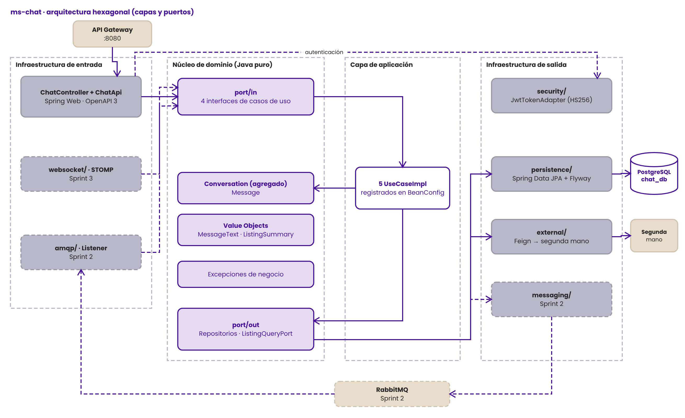
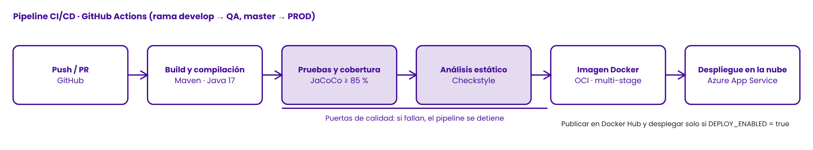
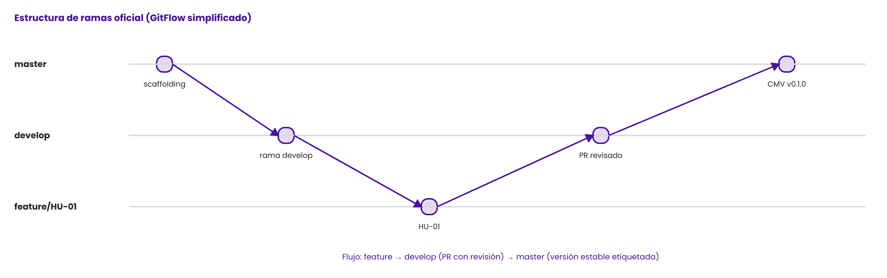

<!-- ==============================================================================
  STYLE RADAR · ms-chat (repositorio GJ-Chat-Service)
  Asignatura: DOSW · 2026-2 · Equipo GJ
  README según SR_Template_README_v1: 12 secciones oficiales en el orden del curso.
============================================================================== -->

<div align="center">

  <a href="https://github.com/StyleRadar1">
    
  </a>

  <h1>STYLE<font color="#5600EF">RADAR</font> &nbsp;·&nbsp; <code>ms-chat</code></h1>

  <p align="center">
    
    
    
  </p>

  <p align="center">
    <strong><font color="#5600EF">Descubre tu estilo. En tu ciudad.</font></strong><br />
    <em>Plataforma de moda local con inventario multi-sede geolocalizado en tiempo real y probador virtual para Bogotá.</em>
  </p>

  <p align="center">
    <a href="https://github.com/StyleRadar1/GJ-Chat-Service/actions/workflows/ci-qa.yml">
      
    </a>
    <a href="#10-cicd-con-el-badge-del-pipeline">
      
    </a>
    <a href="#10-cicd-con-el-badge-del-pipeline">
      
    </a>
    <a href="#9-pruebas-y-cobertura">
      
    </a>
    <a href="#6-tecnologías-y-dependencias">
      
    </a>
    <a href="#6-tecnologías-y-dependencias">
      
    </a>
    <a href="#7-cómo-ejecutar-local-y-con-docker">
      
    </a>
  </p>

</div>

---

##  ÍNDICE DE CONTENIDOS

1. [Nombre del servicio y su bounded context](#1-nombre-del-servicio-y-su-bounded-context)
2. [Equipo y responsables](#2-equipo-y-responsables)
3. [Arquitectura hexagonal con su diagrama](#3-arquitectura-hexagonal-con-su-diagrama)
4. [Endpoints y enlace a Swagger](#4-endpoints-y-enlace-a-swagger)
5. [Eventos que publica y consume](#5-eventos-que-publica-y-consume)
6. [Tecnologías y dependencias](#6-tecnologías-y-dependencias)
7. [Cómo ejecutar local y con Docker](#7-cómo-ejecutar-local-y-con-docker)
8. [Variables de entorno](#8-variables-de-entorno)
9. [Pruebas y cobertura](#9-pruebas-y-cobertura)
10. [CI/CD con el badge del pipeline](#10-cicd-con-el-badge-del-pipeline)
11. [Ramas y cómo contribuir](#11-ramas-y-cómo-contribuir)
12. [Enlace a la épica en Jira](#12-enlace-a-la-épica-en-jira)

**Documentación del servicio**

| Documento | Contenido |
| :--- | :--- |
| [`docs/SR_GJ_DocumentoTecnico_v1.md`](docs/SR_GJ_DocumentoTecnico_v1.md) | Diagramas generales y específicos (hexagonal, clases, base de datos, secuencia) con su explicación |
| [`docs/SR_GJ_AnalisisTecnologias_v1.md`](docs/SR_GJ_AnalisisTecnologias_v1.md) | Criterios, ADR, costos y riesgos de cada tecnología elegida |
| [`docs/SR_GJ_ContratosEventos_v1.md`](docs/SR_GJ_ContratosEventos_v1.md) | Contratos de los eventos que publica y consume el chat |

---

<a id="1-nombre-del-servicio-y-su-bounded-context"></a>

##  1. NOMBRE DEL SERVICIO Y SU BOUNDED CONTEXT

* **Identificador de Servicio:** `ms-chat` (repositorio `GJ-Chat-Service`, artefacto `gj-chat-service`)
* **Paquete Arquitectónico:** `Paquete 3: Notificaciones, Chat y Broker` (Estación Guatoque Jiraguas · bloque de puertos 8300)
* **Puerto de Escucha Oficial:** `8320` (bloque 8300 del equipo; `ms-notificaciones` `8300`, broker RabbitMQ `5672`)
* **Base de Datos Asignada:** `PostgreSQL 15` (`chat_db`), aislada bajo el patrón *Database-per-Service*.
* **Bounded Context:** `Mensajería (Chat)`
* **Requerimientos:** `SR-RF-40` Iniciar chat con vendedor · `SR-RF-41` Coordinar entrega mediante chat interno

### Responsabilidades del Dominio

Este microservicio encapsula exclusivamente la lógica de negocio de las conversaciones privadas entre el comprador y el vendedor de una prenda de segunda mano.

| Qué HACE este Microservicio (Alcance) | Qué NO HACE este Microservicio (Límites) |
| :--- | :--- |
| • Inicia una conversación desde una publicación de segunda mano disponible, una sola por publicación y comprador. | • NO autentica usuarios: valida el JWT que emite el servicio de identidad (`ms-auth` en `:8081`). |
| • Guarda y entrega los mensajes en orden de envío, solo a los participantes. | • NO es dueño de las publicaciones de segunda mano: las consulta al servicio que las administra. |
| • Cierra la conversación cuando la prenda deja de estar disponible. | • NO envía notificaciones ni correos (delegado a `ms-notificaciones` en `:8300`). |
| • Garantiza persistencia ACID e idempotencia en su base de datos. | • NO accede directamente a bases de datos de otros microservicios. |

### Arquetipos de Moda y Personajes de StyleRadar

<div align="center">

| Antonia (Sastre) | Mateo (Calle) | Aura (Futuro) | Nora (Rebelde) | Tomás (Esencial) |
| :---: | :---: | :---: | :---: | :---: |
| <br>**Sastre**<br><sub>Tiendas & Descubrimiento</sub> | <br>**Calle**<br><sub>Playlists & Cultura Urbana</sub> | <br>**Futuro**<br><sub>Probador Virtual AI</sub> | <br>**Rebelde**<br><sub>Segunda Vida & Vintage</sub> | <br>**Esencial**<br><sub>Fundaciones & Donaciones</sub> |

</div>

---

<a id="2-equipo-y-responsables"></a>

##  2. EQUIPO Y RESPONSABLES

Desarrollado y mantenido por el **Equipo `GJ`** (prefijo `GJ`) para la asignatura DOSW 2026-2.

<div align="center">

| Rol | Responsable |
| :---: | :---: |
| **Responsable de ms-chat** | `Santiago Andres Garcia Almario` (`SantiagoAndresGarciaAlmario01`) |
| **Líder del equipo / Paquete 3** | `Paula Díaz` |
| **Colaborador backend** | `Óscar Lasso` |

</div>

---

<a id="3-arquitectura-hexagonal-con-su-diagrama"></a>

##  3. ARQUITECTURA HEXAGONAL CON SU DIAGRAMA

El microservicio implementa **Arquitectura Hexagonal (Puertos y Adaptadores)** combinada con **Domain-Driven Design (DDD)**. Las dependencias apuntan hacia adentro: el **dominio** no conoce Spring, JPA ni HTTP; los **casos de uso** dependen solo de puertos (interfaces); la **infraestructura** implementa esos puertos.

### Diagrama de Capas (draw.io)

<div align="center">



<sub>Editable en draw.io: <a href="docs/diagramas/arquitectura-hexagonal-capas.drawio"><code>arquitectura-hexagonal-capas.drawio</code></a></sub>

</div>

Los adaptadores de RabbitMQ y WebSocket STOMP están implementados; las conexiones en QA usan RabbitMQ por TLS y el endpoint STOMP autentica con JWT.

**Diagramas específicos con su explicación** (en [`docs/SR_GJ_DocumentoTecnico_v1.md`](docs/SR_GJ_DocumentoTecnico_v1.md)):

| Diagrama | Sección del documento técnico |
| :--- | :--- |
| Componentes específico (hexagonal, clase por clase) | [04 · Arquitectura hexagonal específica](docs/SR_GJ_DocumentoTecnico_v1.md#04-arquitectura-hexagonal-específica) |
| Secuencia: enviar un mensaje (llamada Feign) | [04 · Diagrama de secuencia](docs/SR_GJ_DocumentoTecnico_v1.md#04-arquitectura-hexagonal-específica) |
| Clases del dominio | [05 · Modelo de dominio y diagrama de clases](docs/SR_GJ_DocumentoTecnico_v1.md#05-modelo-de-dominio-y-diagrama-de-clases) |
| Base de datos | [06 · Modelo de base de datos](docs/SR_GJ_DocumentoTecnico_v1.md#06-modelo-de-base-de-datos) |

### Estructura Oficial de Paquetes en `src/main/java/`

La capa de puertos sigue la guía hexagonal del curso: los puertos viven en `domain/port`.

```text
src/main/java/edu/dosw/styleradar/chat/
├── domain/                                  <-- NÚCLEO DE DOMINIO (cero dependencias externas)
│   ├── model/                               <-- Conversation (agregado), Message, MessageText (VO), ListingSummary (VO)
│   ├── event/                               <-- Eventos de dominio (MessageSentEvent)
│   ├── exception/                           <-- Excepciones de reglas de negocio
│   └── port/
│       ├── in/                              <-- Input Ports (interfaces de casos de uso)
│       └── out/                             <-- Output Ports (repositorios y consulta de publicaciones)
├── application/                             <-- CAPA DE APLICACIÓN
│   ├── usecase/                             <-- *UseCaseImpl (sin @Service, se registran en BeanConfig)
│   ├── dto/request · response · event       <-- DTOs como Java Records
│   └── mapper/in · out                      <-- MapStruct
└── infrastructure/                          <-- CAPA DE INFRAESTRUCTURA
    ├── adapter/
    │   ├── in/
    │   │   ├── rest/ (+ doc/)               <-- ChatController y documentación OpenAPI
    │   │   ├── amqp/                        <-- Consumidor RabbitMQ de la venta de una prenda
    │   │   └── websocket/                   <-- STOMP en tiempo real autenticado por JWT
    │   └── out/
    │       ├── persistence/                 <-- Entidades JPA, Spring Data y adaptadores
    │       ├── external/                    <-- Cliente Feign del servicio de publicaciones
    │       ├── security/                    <-- Validación del JWT
    │       └── messaging/                   <-- Publicador RabbitMQ de mensajes enviados
    ├── config/                              <-- BeanConfig, SecurityConfig, FeignConfig, OpenApiConfig
    └── exception/                           <-- GlobalExceptionHandler (RFC 7807)
```

---

<a id="4-endpoints-y-enlace-a-swagger"></a>

##  4. ENDPOINTS Y ENLACE A SWAGGER

La documentación interactiva OpenAPI 3.0 trae, para cada endpoint, descripción, ejemplos de request y response y los códigos de error con su ejemplo en formato RFC 7807.

### Matriz Oficial de Enlaces por Entorno (PROD, QA, LOCAL)

| Entorno | Estado | Propósito | URL Base del Servicio | Swagger OpenAPI UI | Health Check |
| :--- | :---: | :--- | :--- | :--- | :--- |
| **Producción (PROD)** | Pendiente | Despliegue productivo | Se publica con el tag `v*.*.*` (`ci-prod.yml`) | — | — |
| **Calidad / Pruebas (QA)** | CI listo; despliegue Azure bloqueado | Pruebas integradas del sprint | App Service `gj-chat-service-qa-santi` y PostgreSQL QA creados. Build, pruebas, análisis y publicación de la imagen completados; falta completar el despliegue Azure. | Pendiente hasta completar el despliegue | Pendiente hasta completar el despliegue |
| **Desarrollo Local (DEV)** | Activo | Desarrollo en la máquina local | `http://localhost:8320` | [Swagger UI Local](http://localhost:8320/swagger-ui.html) | [`/actuator/health`](http://localhost:8320/actuator/health) |

* **Especificación OpenAPI (Contrato JSON):** `http://localhost:8320/v3/api-docs`
* **Rutas públicas:** `/actuator/health`, `/swagger-ui.html` y `/v3/api-docs`. Todo lo demás exige JWT.

<div align="center">
  <table width="100%" style="margin: 18px 0; border: 2px dashed #5600EF; border-radius: 8px; background-color: #FBFBFE;">
    <tr>
      <td align="center" style="padding: 22px;">
        <p>
          <br />
          <strong><font color="#5600EF" size="3">DOCUMENTACIÓN SWAGGER OPENAPI UI ACTIVA</font></strong>
        </p>
        <p>
          <sub>Captura de <code>http://localhost:8320/swagger-ui.html</code> con los 4 endpoints del chat.</sub>
        </p>
        <p>
<!-- Al generar tu captura, descomenta la siguiente línea y guarda la imagen en la ruta indicada: -->
<!-- <br /> -->
          <code>[ Pegar captura de Swagger UI aquí · docs/evidencias/swagger-ui.png ]</code>
        </p>
      </td>
    </tr>
  </table>
</div>

### Tabla de Endpoints Expuestos

Todos exigen `Authorization: Bearer <JWT>`. El usuario se toma siempre del token, nunca de la URL.

| Método | Endpoint | Descripción | Rol Requerido | Códigos HTTP |
| :---: | :--- | :--- | :--- | :---: |
| `GET` | `/actuator/health` | Estado del microservicio | Público | `200` |
| `POST` | `/api/v1/segunda-mano/{publicacionId}/conversaciones` | Inicia el chat con el vendedor. Si ya existe, devuelve la misma conversación. | `COMPRADOR` | `200`, `401`, `403`, `404`, `422`, `503` |
| `GET` | `/api/v1/usuarios/me/conversaciones` | Conversaciones donde participo, como comprador o vendedor | `COMPRADOR` | `200`, `401`, `403` |
| `GET` | `/api/v1/conversaciones/{id}/mensajes` | Mensajes de la conversación en orden de envío | `COMPRADOR` (participante) | `200`, `401`, `403`, `404` |
| `POST` | `/api/v1/conversaciones/{id}/mensajes` | Envía un mensaje de hasta 1.000 caracteres; una conversación cerrada no acepta escritura | `COMPRADOR` (participante) | `201`, `400`, `401`, `403`, `404`, `409`, `503` |

<details>
<summary><b>Click para ver Ejemplos de Request y Response JSON (Payloads)</b></summary>

<br>

#### Ejemplo Request (`POST /api/v1/segunda-mano/10/conversaciones`)

```bash
curl -X POST "http://localhost:8320/api/v1/segunda-mano/10/conversaciones" \
  -H "Authorization: Bearer <JWT_TOKEN>"
```

#### Ejemplo Response Exitoso (`200 OK`)

```json
{
  "id": 7,
  "publicacionId": 10,
  "prendaNombre": "Chaqueta de jean",
  "compradorId": 1,
  "vendedorId": 2,
  "estado": "ABIERTA",
  "fechaCreacion": "2026-11-01T15:00:00Z"
}
```

#### Ejemplo Request (`POST /api/v1/conversaciones/7/mensajes`)

```bash
curl -X POST "http://localhost:8320/api/v1/conversaciones/7/mensajes" \
  -H "Content-Type: application/json" \
  -H "Authorization: Bearer <JWT_TOKEN>" \
  -d '{ "texto": "¿Sigue disponible? Podría recogerla el sábado en Chapinero." }'
```

#### Ejemplo Response Exitoso (`201 Created`)

```json
{
  "id": 20,
  "conversacionId": 7,
  "autorId": 1,
  "texto": "¿Sigue disponible? Podría recogerla el sábado en Chapinero.",
  "fechaEnvio": "2026-11-01T15:05:00Z"
}
```

#### Ejemplo de Error (`422 Unprocessable Entity`, `application/problem+json`)

```json
{
  "type": "https://styleradar.dosw/errores/regla-de-negocio",
  "title": "Regla de negocio incumplida",
  "status": 422,
  "detail": "No puede iniciar un chat sobre su propia publicación",
  "instance": "/api/v1/segunda-mano/10/conversaciones",
  "timestamp": "2026-11-01T15:00:00Z"
}
```

</details>

---

<a id="5-eventos-que-publica-y-consume"></a>

##  5. EVENTOS QUE PUBLICA Y CONSUME

La comunicación asíncrona usa **RabbitMQ** con Topic Exchanges durables desde el **Sprint 2**: el chat publica `MensajeEnviadoEvent` al guardar un mensaje y consume `PrendaSegundaManoVendidaEvent` para cerrar las conversaciones de los demás compradores. El consumidor es idempotente (tabla `processed_events` por `eventId`) y, tras 3 reintentos, los mensajes fallidos van a `q.chat.segunda-mano.dlq` por `styleradar.dlx`. El cierre por retiro sigue detectándose con la consulta Feign en cada envío.

* **Exchange Principal de Dominio:** `styleradar.exchange` (`topic`, durable)
* **Exchange de Auditoría:** `styleradar.audit` (`fanout`, durable)
* **Dead Letter Exchange (DLX):** `styleradar.dlx`

### Matriz de Eventos AMQP

| Tipo | Evento | Routing Key | Cola (Queue) | Microservicio Emisor / Receptor | Cuándo se Dispara / Acción |
| :---: | :--- | :--- | :--- | :--- | :--- |
| **PUBLICA** | `MensajeEnviadoEvent` | `styleradar.chat.mensaje.enviado` | N/A (Exchange) | `ms-chat` &rarr; `ms-notificaciones` | Se publica al guardar un mensaje. Notificaciones avisa al destinatario. |
| **CONSUME** | `PrendaSegundaManoVendidaEvent` | `styleradar.segundavida.prenda.vendida` | `q.chat.segunda-mano` | Paquete Catálogo &rarr; `ms-chat` | Cierra las conversaciones de los demás compradores; la del comprador que se quedó con la prenda sigue abierta para coordinar la entrega. |
| **CONSUME** | `PrendaSegundaManoRetiradaEvent` *(propuesto)* | `segunda-mano.prenda.retirada` | `q.chat.segunda-mano` | Paquete Catálogo &rarr; `ms-chat` | Cierra las conversaciones cuando el vendedor retira la publicación. |

El detalle de cada campo, las reglas de idempotencia y el estado de aprobación con los equipos productores y consumidores están en [`docs/SR_GJ_ContratosEventos_v1.md`](docs/SR_GJ_ContratosEventos_v1.md).

<details>
<summary><b>Click para ver Esquema JSON del Evento Publicado (con Idempotencia)</b></summary>

<br>

```json
{
  "eventId": "018f2c1a-7b3e-7000-8000-00000000a001",
  "eventType": "styleradar.chat.mensaje.enviado",
  "version": 1,
  "timestamp": "2026-11-10T15:05:00Z",
  "producer": "ms-chat",
  "correlationId": "c0a8012e-5f1d-4a7b-9e21-3b7c9d2f6a10",
  "data": {
    "mensajeId": 20,
    "conversacionId": 7,
    "publicacionId": 10,
    "prendaNombre": "Chaqueta de jean",
    "autorId": 1,
    "destinatarioId": 2,
    "vistaPrevia": "¿Sigue disponible? Podría recogerla el sábado…",
    "fechaEnvio": "2026-11-10T15:05:00Z"
  }
}
```

</details>

---

<a id="6-tecnologías-y-dependencias"></a>

##  6. TECNOLOGÍAS Y DEPENDENCIAS

Todas las versiones están fijas en el `pom.xml`. El análisis completo está en [`docs/SR_GJ_AnalisisTecnologias_v1.md`](docs/SR_GJ_AnalisisTecnologias_v1.md).

| Capa / Componente | Tecnología | Versión | Justificación Técnica |
| :--- | :--- | :--- | :--- |
| **Lenguaje Core** | Java (Eclipse Temurin) | `17` | LTS que ya usa el monolito, así el dominio se migró sin reescribirlo. |
| **Framework Empresarial** | Spring Boot (Web, Security, Data JPA, Validation, Actuator) | `3.2.12` | Configuración declarativa y ecosistema que el equipo ya domina. |
| **Comunicación síncrona** | Spring Cloud OpenFeign | `2023.0.5` | Consulta la publicación con tiempos límite y reenvío del JWT. |
| **Base de Datos** | PostgreSQL | `15` | ACID y restricción `UNIQUE` para una sola conversación por publicación y comprador. |
| **Migraciones de BD** | Flyway | Gestionada por Spring Boot | Esquema versionado (`V1__init_schema.sql`); Hibernate solo valida. |
| **Broker de Mensajería** | RabbitMQ | Sprint 2 | Desacopla notificaciones y cierre del chat mediante Topic Exchanges. |
| **Seguridad** | JJWT (HS256) | `0.12.6` | Valida el token sin consultar la base de usuarios. |
| **Mapeo de DTOs** | MapStruct · Lombok | `1.6.3` · `1.18.36` | Mappers generados en compilación, sin reflection. |
| **Documentación API** | springdoc-openapi | `2.5.0` | Swagger UI con ejemplos y errores por endpoint. |
| **Testing Core** | JUnit 5 + Mockito | Gestionada por Spring Boot | Pruebas del dominio y casos de uso sin levantar Spring. |
| **Testing Integración** | Testcontainers | Gestionada por Spring Boot | PostgreSQL real en Docker durante `mvn verify`. |
| **Métricas de Cobertura** | JaCoCo | `0.8.12` | Falla el build si dominio y aplicación quedan por debajo del 85 %. |
| **Análisis Estático** | Checkstyle (Google Java Style) | `3.6.0` | Reporte de estilo en cada ejecución del pipeline. |

---

<a id="7-cómo-ejecutar-local-y-con-docker"></a>

##  7. CÓMO EJECUTAR LOCAL Y CON DOCKER

### Prerrequisitos de Entorno

* **Java Development Kit (JDK):** 17 (`java -version`).
* **Apache Maven:** 3.9+ (`mvn -version`).
* **Docker Engine y Docker Compose:** Docker Desktop en ejecución (`docker --version`).

### Ejecución Local con Maven (Perfil Dev)

```bash
# 1. Clonar el repositorio
git clone https://github.com/StyleRadar1/GJ-Chat-Service.git
cd GJ-Chat-Service

# 2. Levantar solo la base de datos en Docker
docker compose up -d postgres

# 3. Ejecutar el microservicio con el perfil dev
export DB_URL=jdbc:postgresql://localhost:5433/chat_db
export DB_PASSWORD=<la misma DB_PASSWORD de tu .env, o chat si no tienes .env>
export JWT_SECRET_BASE64=<llave Base64 de al menos 32 bytes>
mvn clean spring-boot:run -Dspring-boot.run.profiles=dev
```

### Ejecución Contenerizada Completa con Docker

<details>
<summary><b>Click para ver Instrucciones de Docker</b></summary>

<br>

```bash
# 1. Crear el archivo de variables a partir de la plantilla
cp .env.example .env            # en PowerShell: copy .env.example .env

# 2. Poner la llave JWT en JWT_SECRET_BASE64 (para generar una):
docker run --rm alpine sh -c "head -c 32 /dev/urandom | base64"

# 3. Construir la imagen multi-stage y levantar PostgreSQL + servicio
docker compose up --build

# 4. Apagar
docker compose down
```

El `docker-compose.yml` levanta tres servicios: `postgres` (`postgres:15-alpine`, puerto local `5433`, volumen `chat-data`), `rabbitmq` (`rabbitmq:3.13-management-alpine`, AMQP `5672` y consola de administración `15672`) y `gj-chat-service` (puerto `8320`), que espera a que la base esté sana (`healthcheck`) antes de arrancar.

</details>

### Comprobación de Salud (Health Check)

```bash
curl -s http://localhost:8320/actuator/health
# Esperado: {"status":"UP"}
```

<div align="center">
  <table width="100%" style="margin: 18px 0; border: 2px dashed #5600EF; border-radius: 8px; background-color: #FBFBFE;">
    <tr>
      <td align="center" style="padding: 22px;">
        <p>
          <br />
          <strong><font color="#5600EF" size="3">CONTENEDOR OCI DOCKER EN EJECUCIÓN (docker compose ps)</font></strong>
        </p>
        <p>
          <sub>Captura de <code>docker compose ps</code> con <code>postgres</code> y <code>gj-chat-service</code> en ejecución.</sub>
        </p>
        <p>
<!-- Al generar tu captura, descomenta la siguiente línea y guarda la imagen en la ruta indicada: -->
<!-- <br /> -->
          <code>[ Pegar captura de docker compose ps aquí · docs/evidencias/docker-compose-ps.png ]</code>
        </p>
      </td>
    </tr>
  </table>
</div>

---

<a id="8-variables-de-entorno"></a>

##  8. VARIABLES DE ENTORNO

Las configuraciones sensibles se externalizan como variables de entorno (*Twelve-Factor App*). El `.env` real nunca se sube: solo existe `.env.example`.

| Variable | Descripción | Valor por Defecto (`dev`) | Requerido en Prod |
| :--- | :--- | :--- | :---: |
| `SERVER_PORT` | Puerto HTTP del microservicio | `8320` | No |
| `DB_URL` | URL JDBC de PostgreSQL | `jdbc:postgresql://localhost:5432/chat_db` | Sí |
| `DB_USERNAME` | Usuario de la base de datos | `chat` | Sí |
| `DB_PASSWORD` | Contraseña de la base de datos | `chat` | Sí |
| `JWT_SECRET_BASE64` | Llave Base64 (≥ 256 bits) igual a la del servicio de identidad | — | Sí |
| `RABBITMQ_HOST` | Host del broker RabbitMQ | `localhost` | Sí |
| `RABBITMQ_PORT` | Puerto AMQP del broker | `5672` | No |
| `RABBITMQ_USER` | Usuario del broker | `guest` | Sí |
| `RABBITMQ_PASSWORD` | Contraseña del broker | `guest` | Sí |
| `JWT_ROL_POR_DEFECTO` | Rol heredado si el token no trae `role` ni `roles` | `COMPRADOR` | No |
| `SEGUNDA_MANO_URL` | URL base del servicio de publicaciones de segunda mano | `http://localhost:8080` | Sí |
| `SEGUNDA_MANO_CONNECT_TIMEOUT_MS` | Tiempo límite de conexión de Feign | `3000` | No |
| `SEGUNDA_MANO_READ_TIMEOUT_MS` | Tiempo límite de lectura de Feign | `5000` | No |
| `CORS_ALLOWED_ORIGINS` | Orígenes permitidos, separados por coma | vacío | Sí |

#### Claims JWT aceptados por ms-chat

El adaptador acepta el ID numérico del usuario en `userId` y permite que `sub` sea el correo; por compatibilidad, también acepta el formato heredado con `sub` numérico. Para roles admite `role` como texto o `roles` como lista. El rol compartido `USER` se traduce a `COMPRADOR` en ms-chat; los demás roles no se elevan. Este soporte transicional no sustituye el acuerdo del contrato canónico con ms-identidad. El secreto debe seguir siendo la llave HS256 oficial del ambiente.

<details>
<summary><b>Click para ver la Plantilla de Archivo .env.example</b></summary>

<br>

```dotenv
# Copie este archivo como .env para docker compose. El .env real no se sube al repositorio.
DB_NAME=chat_db
DB_USERNAME=chat
DB_PASSWORD=change-me
DB_PORT=5433
API_PORT=8320
RABBITMQ_PORT=5672
RABBITMQ_MANAGEMENT_PORT=15672
RABBITMQ_USER=guest
RABBITMQ_PASSWORD=change-me
# Debe ser la misma llave con la que ms-identidad firma los tokens.
JWT_SECRET_BASE64=change-me-base64-key
# Servicio dueño de las publicaciones de segunda mano: ms-segunda-vida-donaciones.
SEGUNDA_MANO_URL=http://host.docker.internal:8080
CORS_ALLOWED_ORIGINS=http://localhost:3000
```

</details>

---

<a id="9-pruebas-y-cobertura"></a>

##  9. PRUEBAS Y COBERTURA (≥ 85%)

El `pom.xml` exige una cobertura mínima del **85 %** de líneas en `domain` y `application`, verificada por JaCoCo durante `mvn verify`. Hoy esas capas están al **100 %**.

### Comandos de Ejecución de Pruebas

```bash
# Ejecutar todas las pruebas unitarias y de integración (las de integración necesitan Docker)
mvn clean verify

# Generar únicamente el reporte HTML de JaCoCo
mvn jacoco:report
```

* **Ruta del Reporte HTML:** `target/site/jacoco/index.html` (también se publica como artefacto `reportes-calidad` en el pipeline).

<div align="center">
  <table width="100%" style="margin: 18px 0; border: 2px dashed #5600EF; border-radius: 8px; background-color: #FBFBFE;">
    <tr>
      <td align="center" style="padding: 22px;">
        <p>
          <br />
          <strong><font color="#5600EF" size="3">REPORTE CONSOLIDADO DE COBERTURA JACOCO (≥ 85%)</font></strong>
        </p>
        <p>
          <sub>Captura de <code>target/site/jacoco/index.html</code> con la cobertura de dominio y aplicación.</sub>
        </p>
        <p>
<!-- Al generar tu captura, descomenta la siguiente línea y guarda la imagen en la ruta indicada: -->
<!-- <br /> -->
          <code>[ Pegar captura de JaCoCo ≥ 85% aquí · docs/evidencias/cobertura-jacoco.png ]</code>
        </p>
      </td>
    </tr>
  </table>
</div>

### Pirámide de Pruebas Implementada

`src/test` es espejo de `src/main`. Total: **81 pruebas** (métodos de prueba).

| Nivel de Prueba | Alcance | Tecnologías Utilizadas | Ubicación en el Código | Pruebas |
| :--- | :--- | :--- | :--- | :---: |
| **Unitarias · dominio** | Reglas de `Conversation`, `Message`, `MessageText`, `ListingSummary` | JUnit 5 | `src/test/java/.../domain/model/` | 20 |
| **Unitarias · casos de uso** | Los 5 `*UseCaseImpl`, incluidos los casos negativos, la publicación del evento y la idempotencia | JUnit 5, Mockito | `src/test/java/.../application/usecase/` | 18 |
| **Adaptadores** | Cliente Feign, JWT, publicador RabbitMQ, eventos procesados y consumidor | JUnit 5, Mockito | `src/test/java/.../infrastructure/adapter/` | 20 |
| **Contrato de API** | Endpoints, seguridad (401/403), validación (400) y errores RFC 7807 | `@WebMvcTest`, MockMvc | `src/test/java/.../infrastructure/adapter/in/rest/` | 18 |
| **Integración** | Flujo completo del chat y concurrencia al crear conversaciones | Spring Boot Test, Testcontainers (PostgreSQL 15) | `src/test/java/.../infrastructure/` | 5 |

> [!IMPORTANT]
> **Criterio de Fallo en CI:** el `pom.xml` contiene la regla `<minimum>0.85</minimum>` sobre `domain/**` y `application/**`. Si la cobertura baja de ese valor, `mvn verify` falla y el pipeline bloquea el Pull Request.

---

<a id="10-cicd-con-el-badge-del-pipeline"></a>

##  10. CI/CD CON EL BADGE DEL PIPELINE

[](https://github.com/StyleRadar1/GJ-Chat-Service/actions/workflows/ci-qa.yml)

### Matriz de Pipelines por Entorno (PROD y QA)

| Pipeline | Entorno Destino | Desencadenador (Trigger) | Quality Gate Exigido |
| :--- | :--- | :--- | :--- |
| **CI - QA** (`ci-qa.yml`) | Calidad (`QA`) | Push a `master`, `develop` o `feature/**` y Pull Requests | Build, pruebas, JaCoCo, Checkstyle, imagen, publicación Docker Hub y despliegue QA. |
| **CD - Producción** (`ci-prod.yml`) | Producción (`PROD`) | Tag `v*.*.*` creado al pasar `develop` a `master` | Pruebas + imagen de versión + aprobación manual del ambiente `production` en Azure App Service. |

### Diagrama del Flujo Automatizado (Pipeline Stages)

<div align="center">



<sub>Editable en draw.io: <a href="docs/diagramas/pipeline-ci-cd.drawio"><code>pipeline-ci-cd.drawio</code></a></sub>

</div>

**Estado actual de QA:** el run `CI QA #20` de `feature/websocket-realtime-qa` terminó en verde el 12 de noviembre de 2026, incluyendo el smoke test de `/actuator/health`. El App Service `gj-chat-service-qa-santi` usa una instancia; se mantiene así hasta provisionar y validar Redis Pub/Sub en QA. No registrar secretos en este repositorio.

El workflow configura App Service en el puerto 8320 y habilita WebSockets.

### Chat WebSocket STOMP

- Endpoint de conexión: `/ws` (WebSocket nativo con STOMP).
- En `CONNECT`, enviar `Authorization: Bearer <JWT>` como cabecera nativa STOMP.
- Suscribirse a `/topic/conversations/{conversationId}`; solo se permiten conversaciones en las que participa el usuario autenticado.
- Enviar a `/app/conversations/{conversationId}/messages` con cuerpo JSON `{"text":"Hola"}`. El servicio persiste el mensaje antes de difundirlo al tópico.
- Suscribirse también a `/user/queue/conversations/acks` para recibir la confirmación privada del mensaje guardado, y a `/user/queue/conversations/errors` para errores del emisor. Una conversación cerrada responde con conflicto lógico `409`; no guarda ni distribuye el mensaje.
- Configurar `WEBSOCKET_ALLOWED_ORIGINS` con los orígenes exactos del cliente, separados por comas. Si se omite, usa `CORS_ALLOWED_ORIGINS`.
- Contrato completo, esquema JSON, recuperación tras reconexión y configuración de Redis: [`docs/contrato-websocket-stomp.md`](docs/contrato-websocket-stomp.md).
- Redis Pub/Sub se activa con `WEBSOCKET_REDIS_ENABLED=true` y `REDIS_URL`; mientras no exista Redis de QA, mantener una sola instancia.

<div align="center">
  <table width="100%" style="margin: 18px 0; border: 2px dashed #5600EF; border-radius: 8px; background-color: #FBFBFE;">
    <tr>
      <td align="center" style="padding: 22px;">
        <p>
          <br />
          <strong><font color="#5600EF" size="3">EJECUCIÓN DEL PIPELINE CI/CD EN VERDE</font></strong>
        </p>
        <p>
          <sub>El build, las pruebas, el análisis y la publicación de la imagen pasaron. Azure QA está pendiente de la llave oficial JWT de ms-identidad.</sub>
        </p>
        <p>
<!-- Al generar tu captura, descomenta la siguiente línea y guarda la imagen en la ruta indicada: -->
<!-- <br /> -->
          <code>[ Agregar captura de Actions cuando Azure QA también finalice · docs/evidencias/pipeline-ci-cd.png ]</code>
        </p>
      </td>
    </tr>
  </table>
</div>

---

<a id="11-ramas-y-cómo-contribuir"></a>

##  11. RAMAS Y CÓMO CONTRIBUIR

El equipo sigue **GitFlow adaptado para microservicios**. `master` y `develop` están protegidas y solo reciben cambios por Pull Request con revisión y pipeline en verde.

### Estructura de Ramas Oficial

```text
master                                  <-- Versiones estables (CMV con tag v*.*.*)
└── develop                             <-- Integración del trabajo del equipo (QA)
    ├── feature/scaffolding             <-- Estructura base del servicio
    ├── feature/HU-xx-descripcion-corta <-- Una rama por historia de usuario
    └── bugfix/GJ-xx-descripcion-corta  <-- Corrección de defectos
```

<div align="center">



<sub>Editable en draw.io: <a href="docs/diagramas/estructura-de-ramas.drawio"><code>estructura-de-ramas.drawio</code></a></sub>

</div>

### Convención de Commits (*Conventional Commits*)

```text
<tipo>(<alcance>): <descripción imperativa en español> [#SR-RF-XX]

Ejemplos válidos:
feat(chat): agregar envío de mensajes entre comprador y vendedor [#SR-RF-41]
fix(chat): rechazar mensajes en conversaciones cerradas [#SR-RF-41]
test(dominio): agregar pruebas de MessageText [#SR-RF-41]
docs(readme): aplicar la plantilla oficial del README
```

### Checklist Obligatorio para Pull Requests

- [ ] La rama parte de la versión más reciente de `develop`.
- [ ] El código compila limpiamente con `mvn clean compile`.
- [ ] Todas las pruebas unitarias e integración pasan (`mvn verify`).
- [ ] La cobertura JaCoCo es mayor o igual al 85 %.
- [ ] No se introducen credenciales, contraseñas ni tokens en el código fuente.
- [ ] El PR tiene asignado al menos 1 revisor del equipo antes del merge.

---

<a id="12-enlace-a-la-épica-en-jira"></a>

##  12. ENLACE A LA ÉPICA EN JIRA

### Enlaces de Gestión, Repositorios y Evidencias

* **Épica Oficial del Microservicio (Jira):** `GJ-1 · ms-chat` → `<pegar el enlace de la épica GJ-1>`
* **Tablero Scrum del Equipo (Jira):** `<pegar el enlace del tablero del proyecto GJ>`
* **Repositorio:** [StyleRadar1/GJ-Chat-Service](https://github.com/StyleRadar1/GJ-Chat-Service)
* **API Swagger (local):** [http://localhost:8320/swagger-ui.html](http://localhost:8320/swagger-ui.html)

<div align="center">
  <table width="100%" style="margin: 18px 0; border: 2px dashed #5600EF; border-radius: 8px; background-color: #FBFBFE;">
    <tr>
      <td align="center" style="padding: 22px;">
        <p>
          <br />
          <strong><font color="#5600EF" size="3">TABLERO SCRUM Y SEGUIMIENTO DE LA ÉPICA EN JIRA</font></strong>
        </p>
        <p>
          <sub>Captura del tablero de Jira con la épica GJ-1, sus historias y tareas del sprint.</sub>
        </p>
        <p>
<!-- Al generar tu captura, descomenta la siguiente línea y guarda la imagen en la ruta indicada: -->
<!-- <br /> -->
          <code>[ Pegar captura del Tablero de Jira aquí · docs/evidencias/jira-tablero-epica.png ]</code>
        </p>
      </td>
    </tr>
  </table>
</div>

### Requerimientos Funcionales Asignados

| Código RF | Nombre del Requerimiento | Actor Principal | Criterio de Aceptación Clave |
| :---: | :--- | :--- | :--- |
| `SR-RF-40` | Iniciar chat con vendedor | Comprador | Solo sobre una publicación disponible y ajena; si la conversación ya existe, devuelve la misma. |
| `SR-RF-41` | Coordinar entrega mediante chat interno | Comprador y vendedor | Solo los participantes leen y escriben; máximo 1.000 caracteres; no se escribe si la prenda ya no está disponible. |

| Historia | Descripción | Requerimiento |
| :---: | :--- | :---: |
| `HU-01` | Iniciar chat con el vendedor | `SR-RF-40` |
| `HU-02` | Coordinar la entrega por chat | `SR-RF-41` |
| `HU-03` | Ver mis conversaciones | `SR-RF-41` |
| `HT-01` | Servicio de chat independiente (base, pipeline e imagen propios) | — |
