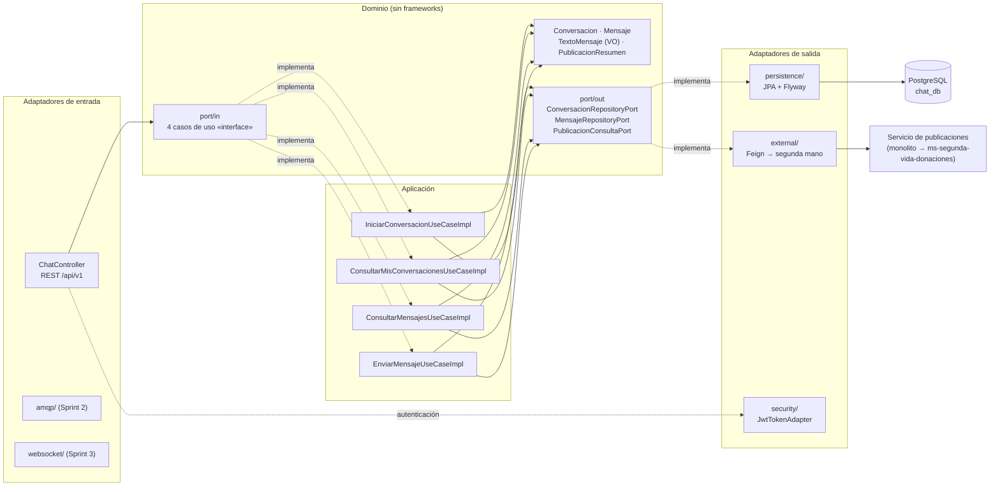
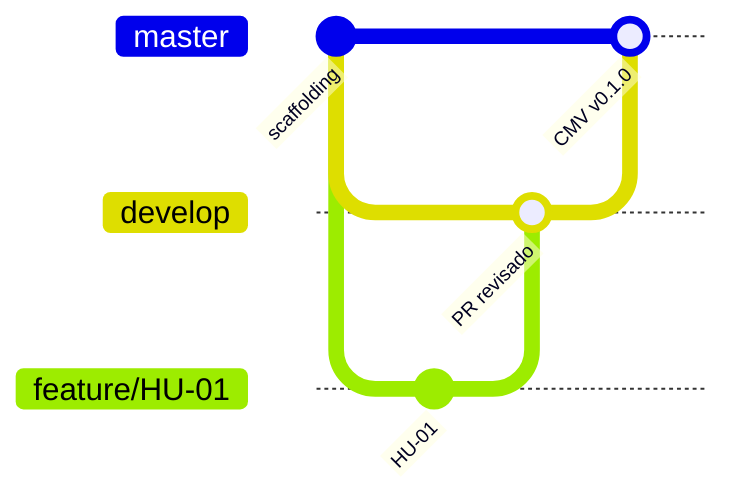

# GJ-Chat-Service · StyleRadar

[](https://github.com/StyleRadar1/GJ-Chat-Service/actions/workflows/ci-qa.yml)
  

> Microservicio de **chat** de StyleRadar, curso DOSW 2026-2, equipo **Guatoque Jiraguas (GJ)**. Documentación técnica completa en [`docs/SR_GJ_DocumentoTecnico_v1.md`](docs/SR_GJ_DocumentoTecnico_v1.md) y análisis de tecnologías en [`docs/SR_GJ_AnalisisTecnologias_v1.md`](docs/SR_GJ_AnalisisTecnologias_v1.md).

## 1. Nombre del servicio y su bounded context

**GJ-Chat-Service** es dueño del bounded context **Mensajería (Chat)**: las conversaciones privadas entre el comprador y el vendedor de una prenda de segunda mano, y los mensajes con que coordinan la entrega.

| Dato | Valor |
| --- | --- |
| Requerimientos | SR-RF-40 (iniciar chat con el vendedor) y SR-RF-41 (coordinar la entrega por chat) |
| Paquete del curso | P3: Chat / Notificaciones |
| Puerto | **8089** |
| Dueño de | `Conversacion`, `Mensaje` |
| No es dueño de | Publicaciones de segunda mano (las consulta por API) ni usuarios (los toma del JWT) |

## 2. Equipo y responsables

| Rol | Integrante |
| --- | --- |
| Responsable del servicio (Backend) | Santiago Andrés García Almario |
| Integrantes del equipo GJ | _Completar con los integrantes del equipo_ |

## 3. Arquitectura hexagonal con su diagrama

Las dependencias apuntan hacia adentro: el **dominio** no conoce Spring, JPA ni HTTP; los **casos de uso** dependen solo de puertos (interfaces); la **infraestructura** implementa esos puertos.



```
src/main/java/edu/dosw/styleradar/chat/
├── domain/          model/ · event/ · exception/ · port/in · port/out
├── application/     usecase/ (*UseCaseImpl) · dto/request|response|event · mapper/in|out (MapStruct)
└── infrastructure/  adapter/in/rest (+doc) · adapter/in/amqp · adapter/in/websocket
                     adapter/out/persistence · adapter/out/external · adapter/out/security · adapter/out/messaging
                     config/ (BeanConfig, SecurityConfig, FeignConfig, OpenApiConfig) · exception/ (RFC 7807)
```

Los casos de uso no llevan `@Service`: se registran a mano en `BeanConfig`. El controlador solo conoce las interfaces de `port/in`.

## 4. Endpoints y enlace a Swagger

**Swagger UI:** `http://localhost:8089/swagger-ui.html` (local) · OpenAPI: `/v3/api-docs`. Cada endpoint trae descripción, ejemplos de request y response y los códigos de error con ejemplo en formato RFC 7807.

Todos exigen `Authorization: Bearer <JWT>` y el rol `COMPRADOR`.

| Método | Ruta | Qué hace | Respuestas |
| --- | --- | --- | --- |
| POST | `/api/v1/segunda-mano/{publicacionId}/conversaciones` | Inicia el chat con el vendedor. Si ya existe, devuelve la misma conversación. | 200, 401, 403, 404, 422, 503 |
| GET | `/api/v1/usuarios/me/conversaciones` | Conversaciones donde participo, como comprador o vendedor. | 200, 401, 403 |
| GET | `/api/v1/conversaciones/{id}/mensajes` | Mensajes de la conversación en orden de envío. Solo participantes. | 200, 401, 403, 404 |
| POST | `/api/v1/conversaciones/{id}/mensajes` | Envía un mensaje de hasta 1.000 caracteres. | 201, 400, 401, 403, 404, 422, 503 |

Ejemplo de error (`application/problem+json`):

```json
{
  "type": "https://styleradar.dosw/errores/regla-de-negocio",
  "title": "Regla de negocio incumplida",
  "status": 422,
  "detail": "No puede iniciar un chat sobre su propia publicación",
  "instance": "/api/v1/segunda-mano/10/conversaciones"
}
```

## 5. Eventos que publica y consume

En el Sprint 1 el servicio todavía no usa el broker: los paquetes `adapter/in/amqp`, `adapter/out/messaging` y `domain/event` ya existen y se llenan en el Sprint 2.

| Evento | Dirección | Publicador → consumidor | Para qué | Sprint |
| --- | --- | --- | --- | --- |
| `MensajeEnviado` | Publica | GJ-Chat-Service → ms-notificaciones | Avisar al destinatario en la campana | 2 |
| `PublicacionRetirada` | Consume | ms-segunda-vida-donaciones → GJ-Chat-Service | Cerrar las conversaciones de esa publicación | 2 |

Broker: RabbitMQ con topic exchange. Mientras no llega el evento, el cierre se detecta consultando la publicación al enviar cada mensaje.

## 6. Tecnologías y dependencias

| Capa | Tecnología | Versión |
| --- | --- | --- |
| Lenguaje | Java (Eclipse Temurin) | 17 |
| Framework | Spring Boot (Web, Security, Data JPA, Validation, Actuator) | 3.2.12 |
| Comunicación entre servicios | Spring Cloud OpenFeign | 2023.0.5 |
| Base de datos y migraciones | PostgreSQL 15 + Flyway | — |
| Seguridad | JJWT (HS256) | 0.12.6 |
| Mappers | MapStruct · Lombok | 1.6.3 · 1.18.36 |
| Documentación | springdoc-openapi (Swagger UI) | 2.5.0 |
| Pruebas | JUnit 5, Mockito, Spring Boot Test, Testcontainers | — |
| Calidad | JaCoCo (≥ 85 %) · Checkstyle (Google Java Style) | 0.8.12 · 3.6.0 |

Todas las versiones están fijas en el `pom.xml`. Justificación de cada decisión en el [análisis de tecnologías](docs/SR_GJ_AnalisisTecnologias_v1.md).

## 7. Cómo ejecutar local y con Docker

**Local** (necesita Java 17 y un PostgreSQL):

```bash
export JWT_SECRET_BASE64=<misma llave del servicio de identidad>
mvn spring-boot:run -Dspring-boot.run.profiles=dev
```

**Docker Compose** (levanta PostgreSQL y el servicio con un solo comando):

```bash
cp .env.example .env        # y poner la llave JWT real
docker compose up --build
```

**Prueba rápida con cURL**:

```bash
TOKEN="<jwt del login>"
curl -X POST http://localhost:8089/api/v1/segunda-mano/1/conversaciones -H "Authorization: Bearer $TOKEN"
curl -X POST http://localhost:8089/api/v1/conversaciones/1/mensajes \
     -H "Authorization: Bearer $TOKEN" -H "Content-Type: application/json" \
     -d '{"texto":"¿Sigue disponible?"}'
```

## 8. Variables de entorno

Los secretos nunca se suben: solo existe `.env.example`.

| Variable | Descripción | Valor por defecto |
| --- | --- | --- |
| `SERVER_PORT` | Puerto del servicio | `8089` |
| `DB_URL` | URL JDBC de PostgreSQL | `jdbc:postgresql://localhost:5432/chat_db` |
| `DB_USERNAME` / `DB_PASSWORD` | Credenciales de la base | `chat` / `chat` |
| `JWT_SECRET_BASE64` | **Obligatoria.** Llave Base64 (≥ 256 bits) igual a la del servicio de identidad | — |
| `JWT_ROL_POR_DEFECTO` | Rol asumido si el token no trae el claim `roles` | `COMPRADOR` |
| `SEGUNDA_MANO_URL` | URL base del servicio de publicaciones | `http://localhost:8080` |
| `SEGUNDA_MANO_CONNECT_TIMEOUT_MS` / `SEGUNDA_MANO_READ_TIMEOUT_MS` | Tiempos límite de Feign | `3000` / `5000` |
| `CORS_ALLOWED_ORIGINS` | Orígenes permitidos, separados por coma | vacío |

## 9. Pruebas y cobertura

```bash
mvn clean verify                  # pruebas + verificación JaCoCo ≥ 85 %
# Reporte: target/site/jacoco/index.html
```

`src/test` es espejo de `src/main`:

| Nivel | Herramienta | Qué cubre |
| --- | --- | --- |
| Unitaria · dominio | JUnit 5 | Reglas de `Conversacion`, `Mensaje`, `TextoMensaje`, `PublicacionResumen` |
| Unitaria · caso de uso | Mockito (sin Spring) | Los 4 `*UseCaseImpl`, incluidos los casos negativos |
| API | `@WebMvcTest` + MockMvc | Endpoints, seguridad (401/403), validación (400) y errores RFC 7807 |
| Adaptadores | JUnit 5 + Mockito | Cliente Feign y validación del JWT |
| Integración · persistencia | Testcontainers (PostgreSQL 15) + Flyway | Flujo completo del chat y concurrencia al crear conversaciones |

Cobertura de líneas en dominio y aplicación: **100 %** (mínimo exigido: 85 %).

## 10. CI/CD con el badge del pipeline

[](https://github.com/StyleRadar1/GJ-Chat-Service/actions/workflows/ci-qa.yml)

| Pipeline | Cuándo corre | Etapas |
| --- | --- | --- |
| `ci-qa.yml` | Push a `master`, `develop` o `feature/**` y PR | Build → pruebas (unitarias + integración) → cobertura JaCoCo → análisis estático Checkstyle → imagen Docker. En `master`, con `DEPLOY_ENABLED=true`, publica en Docker Hub y despliega en Azure QA. |
| `ci-prod.yml` | Tag `v*.*.*` | Pruebas → imagen de versión → despliegue en Azure PROD con aprobación manual. |

Para activar el despliegue: cargar los secrets `DOCKERHUB_USERNAME`, `DOCKERHUB_TOKEN`, `AZURE_CREDENTIALS`, `AZURE_WEBAPP_NAME_QA`, `DB_URL_QA`, `DB_USERNAME_QA`, `DB_PASSWORD_QA`, `JWT_SECRET_QA` y `SEGUNDA_MANO_URL_QA`, y crear la variable `DEPLOY_ENABLED=true`.

## 11. Ramas y cómo contribuir



- Dos ramas fijas: **`master`** y **`develop`**. Nunca se hacen commits directos en ellas.
- Cada cambio sale de `develop` en una rama `feature/scaffolding` o `feature/HU-xx` y vuelve a `develop` por **Pull Request con revisión** y pipeline en verde.
- Al pasar de `develop` a `master` se crea el **CMV** con un tag `v*.*.*`.
- Mensajes de commit en español e imperativo, por ejemplo `Agrega validación del texto del mensaje`.

## 12. Enlace a la épica en Jira

**Épica:** _GJ-Chat-Service_ → _pegar aquí el enlace de la épica en Jira_

Historias del Sprint 1: HU-01 Iniciar chat con el vendedor (SR-RF-40) · HU-02 Coordinar la entrega por chat (SR-RF-41) · HU-03 Ver mis conversaciones (SR-RF-41) · HT-01 Servicio de chat independiente.
