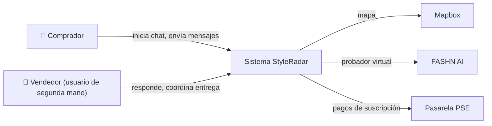
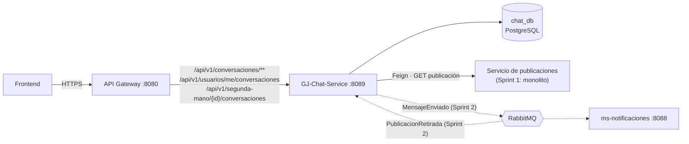
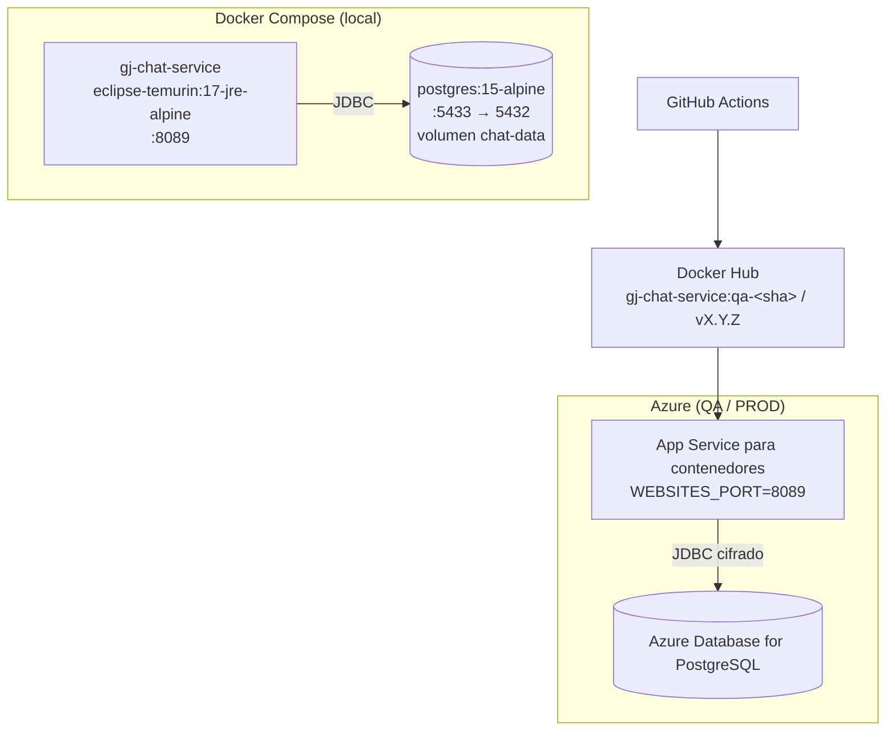
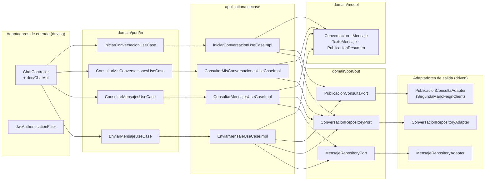
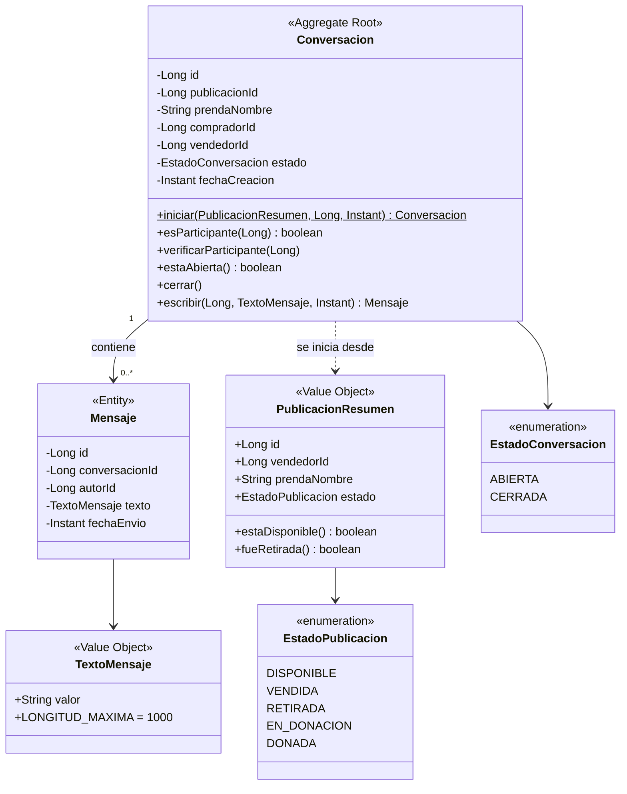
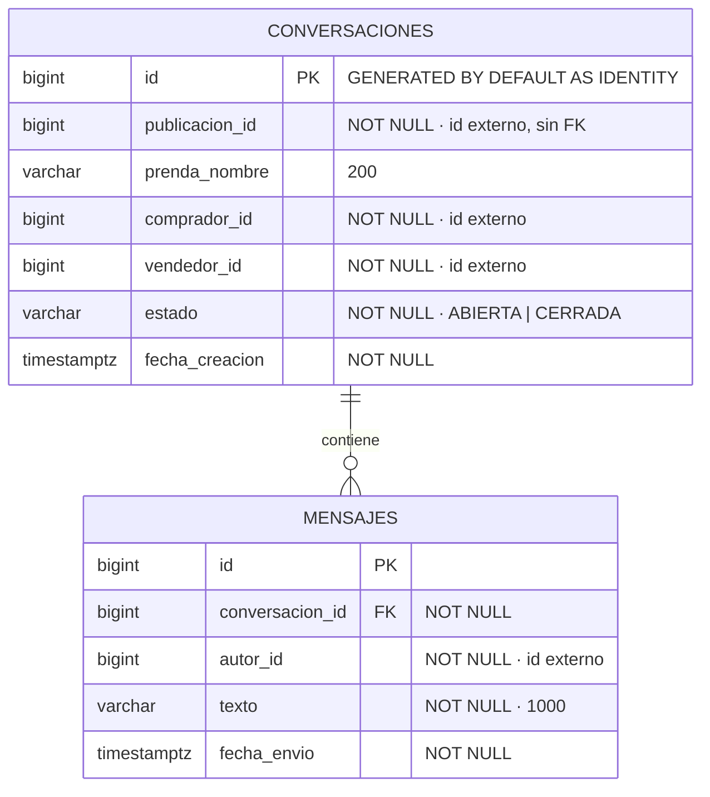

# SR_GJ_DocumentoTecnico_v1 · GJ-Chat-Service

**STYLE RADAR · Documento técnico de arquitectura · DOSW 2026-2**

| Campo | Valor |
| --- | --- |
| Microservicio | GJ-Chat-Service (`gj-chat-service`, puerto 8089) |
| Dominio / Paquete | P3: Chat / Notificaciones · bounded context **Mensajería** |
| Equipo | Guatoque Jiraguas (GJ) · Responsable: Santiago Andrés García Almario |
| Versión · Fecha | v1.0 · 3 de noviembre de 2026 (Sprint 1) |

> **Regla de oro:** cada diagrama va con su explicación y justificación. Los diagramas están en Mermaid dentro de este archivo, así que quedan versionados junto al código y GitHub los dibuja directamente.

---

## 00 · Contenido y control de cambios

| Versión | Fecha | Autor / Rol | Cambio | Estado |
| --- | --- | --- | --- | --- |
| v0.1 | 01/11/2026 | Santiago García (Backend) | Scaffolding hexagonal, dominio y casos de uso migrados del monolito | Borrador |
| v1.0 | 03/11/2026 | Santiago García (Backend) | Diagramas específicos, contratos OpenAPI, pruebas y CI/CD | Entregado Sprint 1 |

| Recurso | Ubicación |
| --- | --- |
| Repositorio | `GJ-Chat-Service` (organización del proyecto en GitHub) |
| Swagger UI | `http://localhost:8089/swagger-ui.html` · OpenAPI en `/v3/api-docs` |
| Pipeline | `.github/workflows/ci-qa.yml` y `ci-prod.yml` |
| Esquema de base de datos | `src/main/resources/db/migration/V1__init_schema.sql` |
| Tablero Jira | _Pegar el enlace de la épica GJ-Chat-Service_ |

---

## 01 · Microservicios y tecnologías (fila de este servicio)

| Servicio | Equipo | ¿BD? | Tipo de BD | Framework | Broker |
| --- | --- | --- | --- | --- | --- |
| GJ-Chat-Service | Guatoque Jiraguas (GJ) | Sí | Relacional (PostgreSQL 15) | Spring Boot 3.2 · Java 17 | RabbitMQ (desde Sprint 2) |

**Justificación resumida:** las conversaciones y mensajes son datos con relaciones fijas (un mensaje pertenece a una conversación), restricciones de unicidad (una conversación por publicación y comprador) y consultas ordenadas por fecha; eso lo resuelve una base relacional con transacciones ACID. El detalle de cada decisión está en `SR_GJ_AnalisisTecnologias_v1.md`.

---

## 02 · Diagramas generales (vista del curso, desde este servicio)

Los diagramas generales completos los hace todo el curso. Aquí se muestra cómo encaja GJ-Chat-Service en ellos.

### 2.1 Contexto

El chat lo usan dos usuarios finales: el **comprador**, que inicia la conversación desde una publicación de segunda mano, y el **vendedor**, que responde y acuerda la entrega. El chat no se integra con ningún sistema externo; los sistemas externos del contexto (Mapbox, FASHN AI, PSE) pertenecen a otros servicios.

### 2.2 Componentes general (lo que toca el chat)

El frontend nunca llama al chat directamente: entra por el **API Gateway**, que valida el JWT y enruta. El chat tiene **su propia base de datos** y no lee la de ningún otro servicio. Lo único que necesita de otro contexto (el estado y el dueño de una publicación) lo pide por **REST con Feign**, porque necesita la respuesta en ese momento para decidir si deja iniciar el chat. Las notificaciones y el cierre por publicación retirada no necesitan respuesta inmediata, por eso irán por **eventos en RabbitMQ**: así el chat no depende de que ms-notificaciones esté arriba.

### 2.3 Despliegue

En local, `docker compose up --build` levanta la base y el servicio; el servicio espera a que PostgreSQL esté sano (`healthcheck`) antes de arrancar. En la nube, GitHub Actions construye la imagen multi-stage, la publica en Docker Hub y la despliega en un App Service con sus variables de entorno (`DB_URL`, `JWT_SECRET_BASE64`, `SEGUNDA_MANO_URL`). La misma imagen corre en los dos ambientes; solo cambian las variables.

---

## 03 · Contexto y alcance del servicio

| HU / RF | Historia de usuario | Criterio de aceptación principal | Estado |
| --- | --- | --- | --- |
| HU-01 · SR-RF-40 | Como comprador, quiero iniciar una conversación con el dueño de una prenda de segunda mano, para preguntarle por ella antes de comprarla. | Solo sobre publicaciones disponibles y ajenas; si ya existe, devuelve la misma | Implementado |
| HU-02 · SR-RF-41 | Como comprador o vendedor, quiero enviar y leer mensajes, para acordar el lugar y el momento de la entrega. | Solo participantes; máximo 1.000 caracteres; no se escribe si la publicación fue retirada | Implementado |
| HU-03 · SR-RF-41 | Como usuario, quiero ver mis conversaciones como comprador y como vendedor, para retomarlas. | El usuario sale del JWT, nunca de la URL | Implementado |
| HT-01 | Como equipo, queremos el chat como servicio independiente con su base, pipeline e imagen Docker. | Arranca solo, sin llaves foráneas a otros servicios, pipeline en verde | Implementado |

| Servicio relacionado | Relación | Canal | Propósito |
| --- | --- | --- | --- |
| API Gateway | Upstream | HTTP/REST | Recibe las peticiones con el JWT |
| Servicio de publicaciones (monolito → ms-segunda-vida-donaciones) | Downstream | REST (Feign) | Validar estado y dueño de la publicación |
| Servicio de identidad | Emisor del JWT | Llave HS256 compartida | Autenticar sin consultar la base de usuarios |
| ms-notificaciones | Downstream | RabbitMQ (Sprint 2) | Avisar mensajes nuevos |

> **Aislamiento de dominio:** el servicio no accede a la base de ningún otro. Publicaciones y usuarios se guardan solo como ids (`publicacionId`, `compradorId`, `vendedorId`, `autorId`).

---

## 04 · Arquitectura hexagonal específica

**Explicación.** Los adaptadores de entrada traducen HTTP: `JwtAuthenticationFilter` valida el token y deja al usuario en el contexto, y `ChatController` solo conoce las interfaces de `port/in`. Cada caso de uso es una interfaz con su `*UseCaseImpl` en `application/usecase`, registrado como `@Bean` en `BeanConfig` (sin `@Service`). Las reglas del negocio viven en el dominio y no dependen de Spring ni de JPA. Los casos de uso piden lo externo por puertos de salida, que implementan los adaptadores: JPA para la base y Feign para el servicio de publicaciones.

**Flujo de una petición (enviar mensaje):** `POST /api/v1/conversaciones/7/mensajes` → `JwtAuthenticationFilter` (usuario 1 desde el JWT) → `ChatController` convierte el JSON a `TextoMensaje` con `MensajeDtoInMapper` → `EnviarMensajeUseCase.enviar(1, 7, texto)` → `EnviarMensajeUseCaseImpl` busca la conversación por `ConversacionRepositoryPort`, verifica que el usuario participe y, si sigue abierta, consulta la publicación por `PublicacionConsultaPort` → `Conversacion.escribir(...)` aplica las reglas y crea el `Mensaje` → `MensajeRepositoryPort.guardar` → `MensajeRepositoryAdapter` lo convierte a `MensajeJpaEntity` y lo persiste → la respuesta vuelve como `MensajeResponse` (201).

**Justificación.** Separar así permite cambiar de dónde sale la publicación (hoy el monolito, después ms-segunda-vida-donaciones, o un evento) cambiando solo un adaptador, y probar todas las reglas con JUnit y Mockito sin levantar Spring ni una base de datos.

---

## 05 · Modelo de dominio y diagrama de clases

**Explicación.** `Conversacion` es el agregado raíz: toda escritura pasa por `escribir(...)`, que garantiza las invariantes (solo participantes, conversación abierta). `Iniciar` es un método de fábrica que exige una publicación disponible y ajena. `Mensaje` es inmutable una vez creado. `TextoMensaje` es un value object: valida al crearse que el texto no esté vacío, le quita los espacios sobrantes y limita a 1.000 caracteres, así un texto inválido nunca llega a existir dentro del dominio. `PublicacionResumen` es la copia mínima e inmutable de un dato que pertenece a otro contexto. Las excepciones del dominio (`ConversacionNoEncontradaException`, `ConversacionCerradaException`, `PublicacionNoDisponibleException`, `ChatConsigoMismoException`, `TextoMensajeInvalidoException`) no saben de HTTP; la infraestructura las traduce.

**Justificación.** Poner las reglas en el agregado y en value objects evita un modelo anémico: el controlador y los casos de uso no pueden saltarse una validación porque la regla está en el objeto mismo. El evento `MensajeEnviadoEvent` se agrega en el Sprint 2.

---

## 06 · Modelo de base de datos

| Restricción / índice | Para qué |
| --- | --- |
| `UNIQUE (publicacion_id, comprador_id)` | Una sola conversación por publicación y comprador; si dos peticiones llegan a la vez, la base rechaza la segunda y el adaptador devuelve la existente |
| `CHECK (estado IN ('ABIERTA','CERRADA'))` | Solo estados válidos |
| `CHECK (comprador_id <> vendedor_id)` | Nadie conversa consigo mismo, también a nivel de base |
| `ix_conversacion_comprador`, `ix_conversacion_vendedor` | «Mis conversaciones» busca por comprador o vendedor |
| `ix_mensaje_conversacion_fecha (conversacion_id, fecha_envio, id)` | Los mensajes se leen ordenados por fecha sin ordenar en memoria |

**Explicación.** Se eligió PostgreSQL relacional porque el modelo es pequeño, estable y relacional, y porque la unicidad de la conversación debe garantizarse con transacciones ACID. La única llave foránea es interna (mensajes → conversaciones). Publicación, comprador, vendedor y autor son ids de otros servicios y **no tienen llave foránea** (Database per Service). El esquema lo crea Flyway con `V1__init_schema.sql`; Hibernate solo lo valida (`ddl-auto: validate`). Las fechas se guardan con zona horaria en UTC.

---

## 07 · Contratos de API REST y eventos

| Método | Ruta | Descripción | Rol | HTTP |
| --- | --- | --- | --- | --- |
| POST | `/api/v1/segunda-mano/{publicacionId}/conversaciones` | Iniciar chat con el vendedor (idempotente) | COMPRADOR | 200, 401, 403, 404, 422, 503 |
| GET | `/api/v1/usuarios/me/conversaciones` | Mis conversaciones | COMPRADOR | 200, 401, 403 |
| GET | `/api/v1/conversaciones/{id}/mensajes` | Mensajes en orden de envío | COMPRADOR (participante) | 200, 401, 403, 404 |
| POST | `/api/v1/conversaciones/{id}/mensajes` | Enviar mensaje | COMPRADOR (participante) | 201, 400, 401, 403, 404, 422, 503 |

| Evento | Dirección | Exchange · routing key | Payload resumido | Sprint |
| --- | --- | --- | --- | --- |
| `MensajeEnviado` | Publica | `sr.chat.topic` → `mensaje.enviado` | `{ "conversacionId": 7, "autorId": 1, "destinatarioId": 2, "fechaEnvio": "…" }` | 2 |
| `PublicacionRetirada` | Consume | `sr.segunda-mano.topic` → `publicacion.retirada` | `{ "publicacionId": 10, "fecha": "…" }` | 2 |

**Errores RFC 7807:** todas las respuestas de error son `application/problem+json` con `type`, `title`, `status`, `detail`, `instance` y `timestamp`. Los errores de validación agregan `errores` por campo. Cada código tiene su ejemplo en Swagger.

---

## 08 · Pruebas y calidad

| Nivel | Herramienta | Paquete | Pruebas |
| --- | --- | --- | --- |
| Unitarias · dominio | JUnit 5 | `domain.model` | 25 |
| Unitarias · caso de uso | JUnit 5 + Mockito | `application.usecase` | 14 |
| Adaptadores | JUnit 5 + Mockito | `infrastructure.adapter.out` | 14 |
| API | Spring `@WebMvcTest` + MockMvc | `infrastructure.adapter.in.rest` | 17 |
| Integración · persistencia | Spring Boot Test + Testcontainers (PostgreSQL 15) | `infrastructure` | 4 |
| **Total** | | | **74** |

Cobertura JaCoCo de dominio y aplicación: **100 % de líneas** (mínimo 85 %, verificado por `mvn verify`). Análisis estático con Checkstyle (Google Java Style) en el pipeline.

| Evidencia | Dónde se obtiene |
| --- | --- |
| E1 · Swagger UI | `http://localhost:8089/swagger-ui.html` con `docker compose up` |
| E2 · Pipeline en verde | Pestaña Actions del repositorio, workflow **CI QA** |
| E3 · Reporte JaCoCo | Artefacto `reportes-calidad` del pipeline o `target/site/jacoco/index.html` |
| E4 · Contenedor corriendo | `docker compose ps` |

---

## 09 · Checklist de entrega

| Estado | Criterio | Verificación |
| --- | --- | --- |
| ✅ | Estructura hexagonal con interfaz + `Impl` y dominio sin frameworks | Paquetes `domain`, `application`, `infrastructure` |
| ✅ | Dockerfile multi-stage y docker-compose | `docker compose up --build` |
| ✅ | Versiones fijas y secretos fuera del repo | `pom.xml`, `.env.example` |
| ✅ | Pipeline: build → pruebas → análisis estático y cobertura → imagen Docker | `ci-qa.yml` |
| ✅ | Swagger con descripción, ejemplos y códigos de error | `/swagger-ui.html` |
| ✅ | README con las 12 secciones | `README.md` |
| ✅ | Diagramas con explicación: hexagonal, clases y base de datos | Secciones 04, 05 y 06 |
| ⏳ | Despliegue en Azure | Pendiente de crear el App Service y cargar los secrets |
