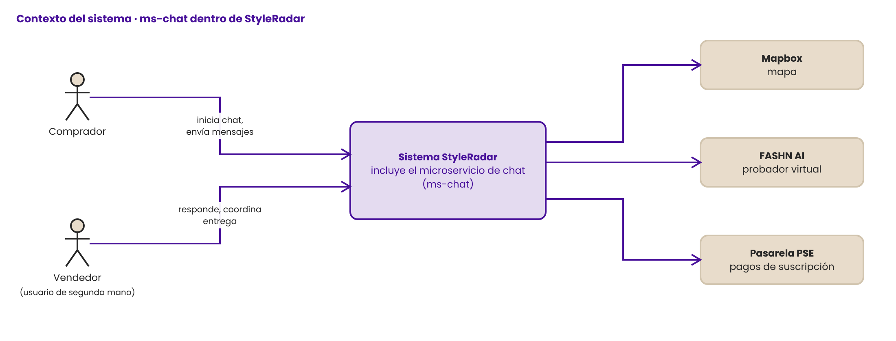
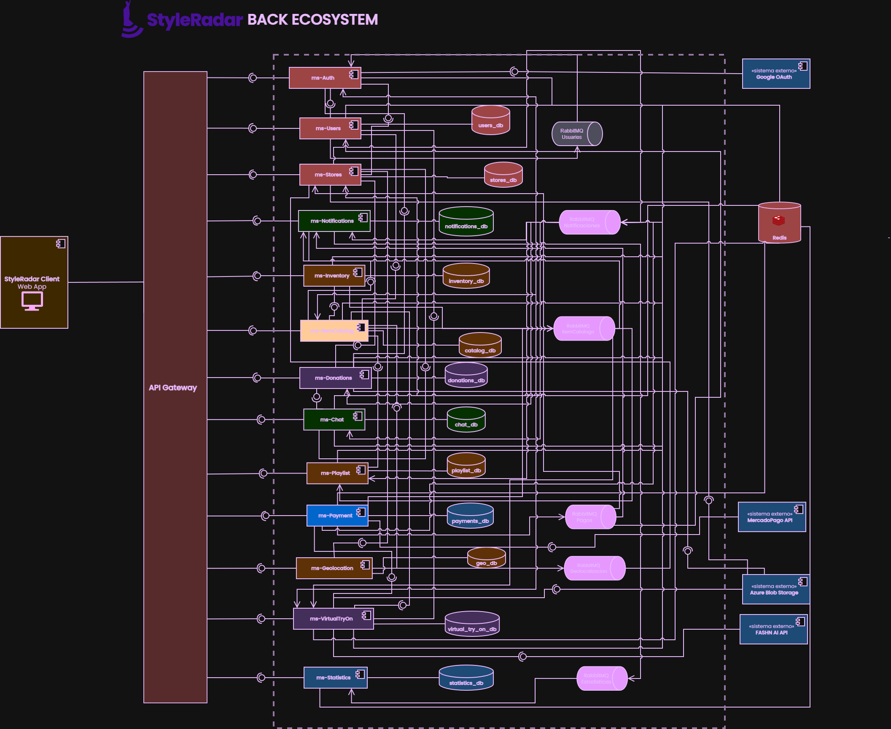
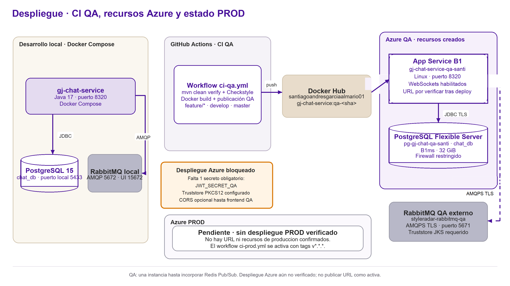
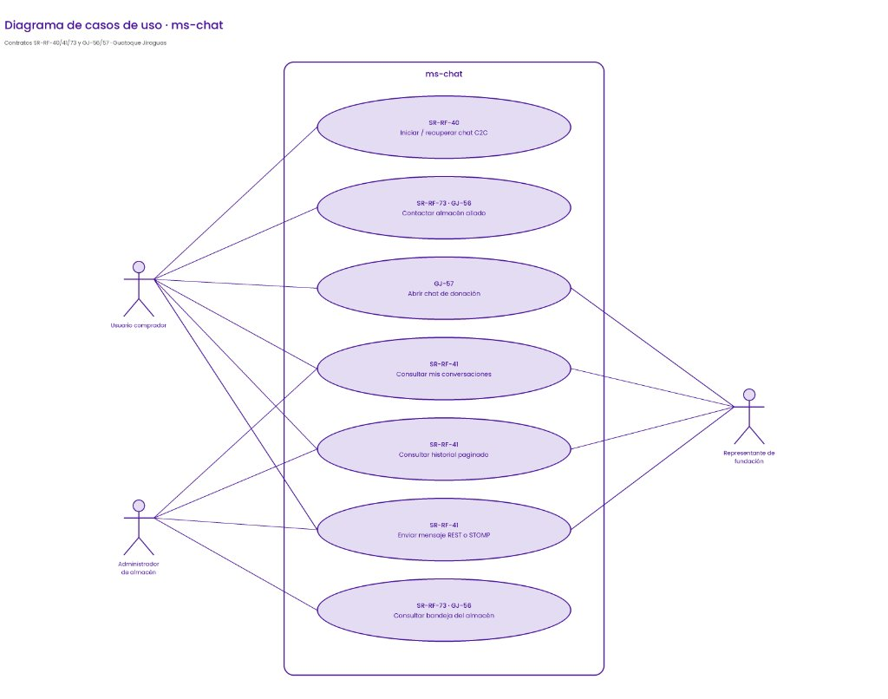
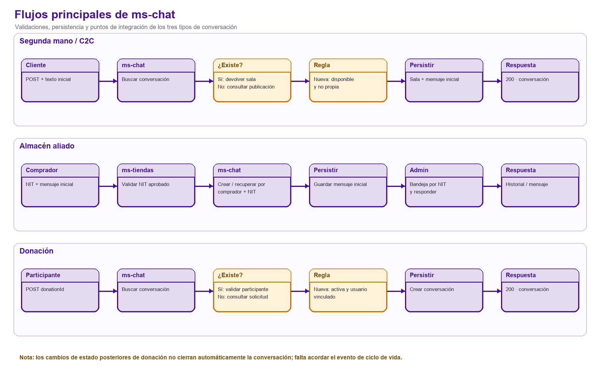
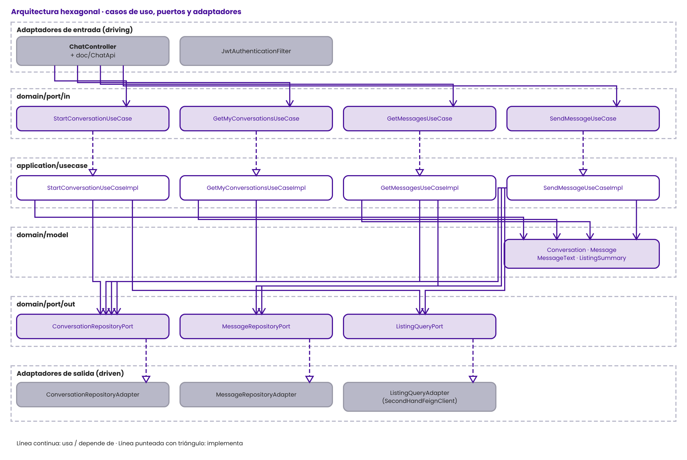
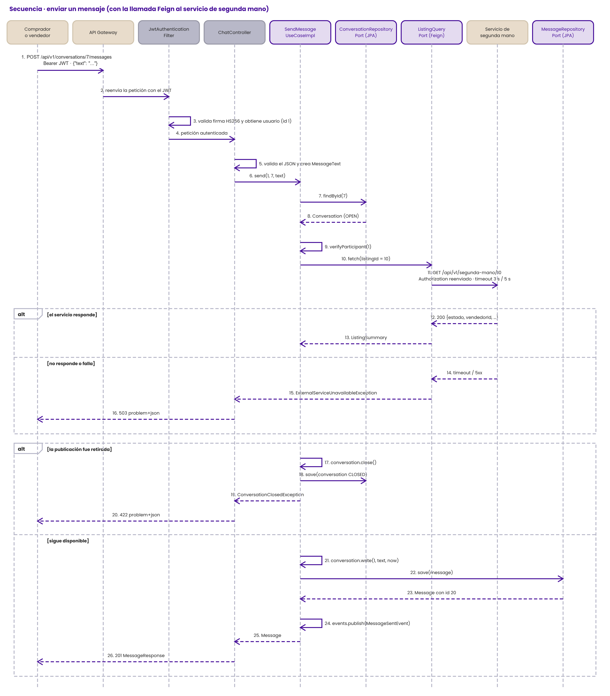
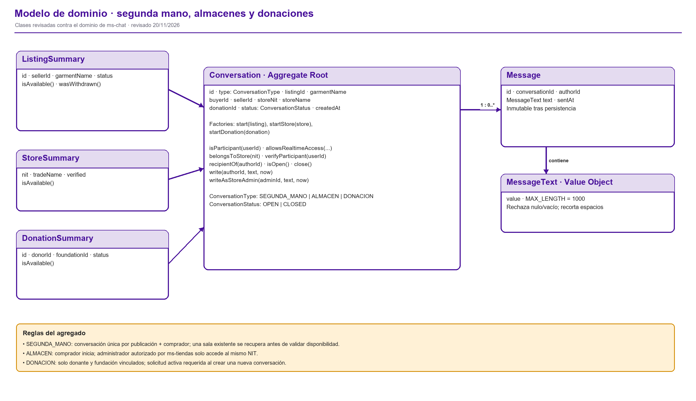
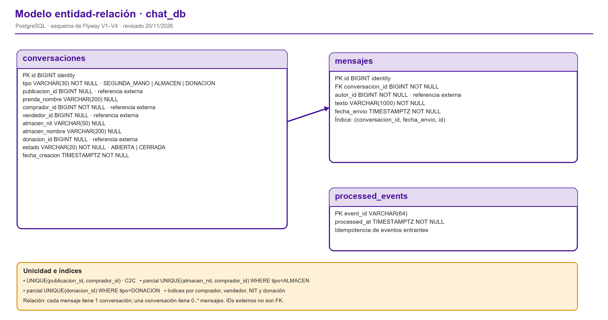

  

  <h1>STYLERADAR &nbsp;·&nbsp; <code>SR_GJ_DocumentoTecnico_v1</code></h1>

  

    
    
    
  

  
<em>Documento técnico de arquitectura de ms-chat · DOSW 2026-2</em>

| Campo | Valor |
| --- | --- |
| Microservicio | GJ-Chat-Service (`gj-chat-service`, puerto 8320) |
| Dominio / Paquete | P3: Chat / Notificaciones · bounded context **Mensajería** |
| Equipo | Guatoque Jiraguas (GJ) · Responsable: Santiago Andrés García Almario |
| Versión · Fecha | v1.3 · 20 de noviembre de 2026 (Sprint 3) |

> **Regla de oro:** cada diagrama va con su explicación y justificación. Los diagramas se editan en draw.io con la plantilla de componentes de StyleRadar y viven en `docs/diagramas/` (un `.drawio` editable y su `.png` por cada uno), así que quedan versionados junto al código.

> **Actualización Sprint 3:** el alcance actual incluye conversaciones de segunda mano, almacenes aliados y donaciones. Esta versión actualiza las secciones de contexto, clases, base de datos e integraciones. Para el contrato funcional vigente y pendientes de aprobación/integración, consultar [`fichas-requerimientos-chat.md`](fichas-requerimientos-chat.md) y [`evidencias/sprint-3-trazabilidad.md`](evidencias/sprint-3-trazabilidad.md).

---

##  CONTENIDO Y CONTROL DE CAMBIOS

| Versión | Fecha | Autor / Rol | Cambio | Estado |
| --- | --- | --- | --- | --- |
| v0.1 | 01/11/2026 | Santiago García (Backend) | Scaffolding hexagonal, dominio y casos de uso migrados del monolito | Borrador |
| v1.0 | 03/11/2026 | Santiago García (Backend) | Diagramas específicos, contratos OpenAPI, pruebas y CI/CD | Entregado Sprint 1 |
| v1.1 | 03/11/2026 | Santiago García (Backend) | Formato de la plantilla oficial, diagrama de secuencia con la llamada Feign y eventos con los nombres de la matriz del curso | Entregado Sprint 1 |
| v1.2 | 06/11/2026 | Santiago García (Backend) | Diagramas migrados de Mermaid a draw.io con la plantilla StyleRadar; puertos 8320 / 8300 | En revisión |
| v1.3 | 20/11/2026 | Equipo ms-chat | Se actualizan el dominio, esquema ER y componentes para almacenes/donaciones; se aclaran estados de integración y seguridad de cuenta | En revisión; aprobación funcional pendiente |

| Recurso | Ubicación |
| --- | --- |
| Repositorio | `GJ-Chat-Service` (organización del proyecto en GitHub) |
| Swagger UI | `http://localhost:8320/swagger-ui.html` · OpenAPI en `/v3/api-docs` |
| Pipeline | `.github/workflows/ci-qa.yml` y `ci-prod.yml` |
| Contratos de eventos | [`SR_GJ_ContratosEventos_v1.md`](SR_GJ_ContratosEventos_v1.md) |
| Esquema de base de datos | `src/main/resources/db/migration/V1__init_schema.sql` a `V4__unique_constraints_almacen_donacion.sql` |
| Tablero Jira | Épica `GJ-1 · ms-chat` · _pegar el enlace de la épica_ |

---

##  MICROSERVICIOS Y TECNOLOGÍAS (FILA DE ESTE SERVICIO)

| Servicio | Equipo | ¿BD? | Tipo de BD | Framework | Broker |
| --- | --- | --- | --- | --- | --- |
| GJ-Chat-Service | Guatoque Jiraguas (GJ) | Sí | Relacional (PostgreSQL 15) | Spring Boot 3.2.12 · Java 21 | RabbitMQ (desde Sprint 2) |

**Justificación resumida:** las conversaciones y mensajes son datos con relaciones fijas (un mensaje pertenece a una conversación), restricciones de unicidad (una conversación por publicación y comprador) y consultas ordenadas por fecha; eso lo resuelve una base relacional con transacciones ACID. El detalle de cada decisión está en `SR_GJ_AnalisisTecnologias_v1.md`.

---

##  DIAGRAMAS GENERALES (VISTA DEL CURSO, DESDE ESTE SERVICIO)

Los diagramas generales completos los hace todo el curso. Aquí se muestra cómo encaja GJ-Chat-Service en ellos.

### 2.1 Contexto

Editable en draw.io: <a href="diagramas/contexto-del-sistema.drawio"><code>contexto-del-sistema.drawio</code></a>

El chat cubre tres relaciones: comprador–vendedor para una publicación de segunda mano (SR-RF-40/41), comprador–administrador de almacén aliado (SR-RF-73/GJ-56) y donante–fundación para una solicitud de donación (GJ-57). Consulta la disponibilidad y participantes a los servicios dueños por Feign; emite eventos de mensaje a ms-notificaciones y consume eventos de venta para cerrar conversaciones. No lee bases de datos de otros microservicios.

### 2.2 Componentes general (lo que toca el chat)

Editable en draw.io: <a href="diagramas/componentes-general.drawio"><code>componentes-general.drawio</code></a>

El frontend usa el **API Gateway** para REST y WebSocket/STOMP. ms-chat valida localmente el JWT HS256 y además autoriza por conversación. El contrato vigente de ms-auth usa `sub` numérico y `roles` como arreglo con `COMPRADOR`, `ADMIN_ALMACEN`, `REPRESENTANTE_FUNDACION` o `ADMIN_STYLERADAR`; el adaptador conserva compatibilidad con nombres anteriores. ms-chat tiene base de datos propia. Usa REST/Feign para consultar publicaciones, almacenes/admins y solicitudes de donación; RabbitMQ para eventos de mensaje y venta; y Redis Pub/Sub opcional para retransmitir STOMP entre instancias. ms-auth emite los JWT; ms-chat no consulta identidad en cada petición. El bloqueo posterior a la emisión del JWT está pendiente de un contrato de estado/revocación con ms-auth. El diagrama específico de estos componentes es [`componentes-ms-chat.png`](diagramas/componentes-ms-chat.png), editable en [draw.io](diagramas/componentes-ms-chat.drawio).

**Integraciones y dependencias de ms-chat:** entrada del frontend vía gateway; autenticación JWT emitida por ms-auth; Feign síncrono con catálogo/segunda mano, ms-tiendas y ms-segunda-vida-donaciones; PostgreSQL propio; RabbitMQ para publicación de mensajes y consumo de eventos de segunda mano; Redis opcional para el relay STOMP. La operación básica del chat depende del JWT y la base propia; los flujos nuevos dependen además de sus servicios propietarios. Los confirms/returns y métricas de ms-chat informan sobre la publicación, pero no garantizan la entrega de la notificación al usuario; la política de entrega se acuerda con ms-notificaciones y el responsable de mensajería.

### 2.3 Despliegue

Editable en draw.io: <a href="diagramas/despliegue.drawio"><code>despliegue.drawio</code></a>

### 2.4 Casos de uso y flujos de conversación

Los actores se separan por rol para mostrar quién inicia o participa en cada tipo de chat. Los flujos muestran validaciones de la primera apertura y persistencia del mensaje inicial; una conversación C2C ya existente se recupera antes de exigir que la publicación siga disponible. El administrador del almacén consulta su bandeja y responde por conversaciones de su almacén. El flujo de donaciones queda sujeto a que el servicio de donaciones confirme participantes y estado.

Editable en draw.io: <a href="diagramas/casos-de-uso-ms-chat.drawio"><code>casos-de-uso-ms-chat.drawio</code></a>

Editable en draw.io: <a href="diagramas/flujos-ms-chat.drawio"><code>flujos-ms-chat.drawio</code></a>

En local, `docker compose up --build` levanta el servicio y dependencias configuradas. El despliegue usa variables para PostgreSQL, `JWT_SECRET_BASE64`, `SEGUNDA_MANO_URL`, `TIENDAS_URL`, `DONACIONES_URL`, RabbitMQ y Redis opcional. La existencia de configuración no acredita por sí sola integración o disponibilidad de los servicios externos; ver el estado y evidencia en la trazabilidad Sprint 3.

---

##  CONTEXTO Y ALCANCE DEL SERVICIO

| HU / RF | Historia de usuario | Criterio de aceptación principal | Estado |
| --- | --- | --- | --- |
| HU-01 · SR-RF-40 | Como comprador, quiero iniciar una conversación con el dueño de una prenda de segunda mano, para preguntarle por ella antes de comprarla. | Solo sobre publicaciones disponibles y ajenas; si ya existe, devuelve la misma | Implementado |
| HU-02 · SR-RF-41 | Como comprador o vendedor, quiero enviar y leer mensajes, para acordar el lugar y el momento de la entrega. | Solo participantes; máximo 1.000 caracteres; no se escribe si la publicación fue retirada | Implementado |
| HU-03 · SR-RF-41 | Como usuario, quiero ver mis conversaciones como comprador y como vendedor, para retomarlas. | El usuario sale del JWT, nunca de la URL | Implementado |
| HU-04 · SR-RF-73 / GJ-56 | Como comprador, quiero contactar un almacén aliado; como su administrador, quiero responder a la bandeja. | Inicio con mensaje, bandeja y autorización por NIT | Implementado en `develop`; integración pendiente |
| HU-05 · GJ-57 | Como donante o representante de fundación, quiero conversar sobre una solicitud de donación. | Participantes ligados a la solicitud; nueva conversación solo si está activa | Incluido en código; integración pendiente |
| HT-01 | Como equipo, queremos el chat como servicio independiente con su base, pipeline e imagen Docker. | Arranca solo, sin llaves foráneas a otros servicios, pipeline en verde | Implementado |

| Servicio relacionado | Relación | Canal | Propósito |
| --- | --- | --- | --- |
| API Gateway | Upstream | HTTP/REST | Recibe las peticiones con el JWT |
| Servicio de publicaciones de segunda mano (Sprint 1: monolito; después: paquete Catálogo) | Downstream | REST (Feign) y eventos (Sprint 2) | Validar estado y dueño de la publicación; cerrar el chat cuando se vende o se retira |
| ms-tiendas | Downstream | REST (Feign) | Validar almacén aliado y resolver el NIT del administrador |
| ms-segunda-vida-donaciones | Downstream | REST (Feign) | Consultar solicitud de donación y participantes |
| Servicio de identidad | Emisor del JWT | Llave HS256 compartida | Autenticar sin consultar la base de usuarios |
| ms-notificaciones | Downstream | RabbitMQ (Sprint 2) | Avisar mensajes nuevos (`MensajeEnviadoEvent`) |
| RabbitMQ | Broker | AMQPS / eventos | Publicar mensajes y consumir evento de venta; confirms/returns detectan ciertos fallos, sin garantizar la notificación final |
| Redis | Distribución opcional | Pub/Sub | Relay de mensajes STOMP entre instancias; no almacena historial |

> **Aislamiento de dominio:** el servicio no accede a la base de ningún otro. Publicaciones y usuarios se guardan solo como ids (`publicacionId`, `compradorId`, `vendedorId`, `autorId`).

---

##  ARQUITECTURA HEXAGONAL ESPECÍFICA

Editable en draw.io: <a href="diagramas/arquitectura-hexagonal-detalle.drawio"><code>arquitectura-hexagonal-detalle.drawio</code></a>

**Explicación.** Los adaptadores de entrada REST/STOMP autentican la petición y llaman a puertos de entrada. Cada caso de uso tiene su implementación en `application/usecase`; las invariantes viven en el dominio. Los puertos de salida conectan con JPA/PostgreSQL, Feign para publicaciones/tiendas/donaciones, RabbitMQ para eventos y Redis Pub/Sub opcional para retransmisión entre instancias.

**Flujo de una petición (enviar mensaje):** `POST /api/v1/conversations/7/messages` → `JwtAuthenticationFilter` (usuario 1 desde el JWT) → `ChatController` convierte el JSON a `MessageText` con `MessageDtoInMapper` → `SendMessageUseCase.send(1, 7, texto)` → `SendMessageUseCaseImpl` busca la conversación por `ConversationRepositoryPort`, verifica que el usuario participe y, si sigue abierta, consulta la publicación por `ListingQueryPort` → `Conversation.write(...)` aplica las reglas y crea el `Message` → `MessageRepositoryPort.save` → `MessageRepositoryAdapter` lo convierte a `MessageJpaEntity` y lo persiste → la respuesta vuelve como `MessageResponse` (201).

**Justificación.** Los adaptadores aíslan los contratos de otros microservicios; el dominio conserva autorización y reglas de estado sin depender de Feign, RabbitMQ, Redis o JPA.

### Diagrama de secuencia · enviar un mensaje (actualiza la secuencia 7.5 con la llamada Feign)

Editable en draw.io: <a href="diagramas/secuencia-enviar-mensaje.drawio"><code>secuencia-enviar-mensaje.drawio</code></a>

**Explicación.** El diagrama recorre el caso de uso de SR-RF-41 de punta a punta. La autenticación ocurre una sola vez, en el filtro; el controlador y el caso de uso reciben el id del usuario ya validado. El cambio frente a la secuencia 7.5 del monolito son los pasos 10 y 11: como la publicación ya no vive en la misma base, el caso de uso la pide por `ListingQueryPort`, y el adaptador Feign hace la llamada HTTP al servicio dueño, reenviando el mismo JWT y con tiempos límite de 3 s para conectar y 5 s para leer.

**Justificación.** La llamada es síncrona porque el chat necesita saber en ese momento si la publicación sigue disponible antes de guardar el mensaje. Si el servicio de publicaciones no responde, el chat devuelve un `503` claro en lugar de quedarse esperando. En el Sprint 2 esta consulta se reemplaza por los eventos de [`SR_GJ_ContratosEventos_v1.md`](SR_GJ_ContratosEventos_v1.md): el chat cerrará la conversación al recibir el evento y ya no tendrá que llamar al otro servicio en cada mensaje.

---

##  MODELO DE DOMINIO Y DIAGRAMA DE CLASES

Editable en draw.io: <a href="diagramas/modelo-de-dominio-clases.drawio"><code>modelo-de-dominio-clases.drawio</code></a>

**Explicación.** `Conversation` es el agregado raíz para `SEGUNDA_MANO`, `ALMACEN` y `DONACION`. Sus fábricas validan publicación, almacén o solicitud; el agregado controla participación, autorización de administrador por NIT, estado abierto y escritura. `Message` se persiste ligado a la conversación; `MessageText` rechaza texto vacío y más de 1.000 caracteres. `ListingSummary`, `StoreSummary` y `DonationSummary` son datos mínimos del contexto externo. En DONACION, el estado externo se consulta al crear una sala nueva, pero no se revalida en cada envío: el cierre automático cuando cambia la solicitud aún requiere un contrato de eventos con ms-segunda-vida-donaciones. Las excepciones de dominio se traducen a HTTP en infraestructura.

**Justificación.** Poner las reglas en el agregado y value objects evita que controladores salten validaciones. El esquema y los tres tipos de conversación están representados en el diagrama actualizado.

---

##  MODELO DE BASE DE DATOS

Editable en draw.io: <a href="diagramas/modelo-entidad-relacion.drawio"><code>modelo-entidad-relacion.drawio</code></a>

| Restricción / índice | Para qué |
| --- | --- |
| `UNIQUE (publicacion_id, comprador_id)` | Una sola conversación C2C por publicación y comprador |
| `uq_conversacion_almacen_comprador` parcial | Una sola conversación por almacén (NIT) y comprador para tipo `ALMACEN` |
| `uq_conversacion_donacion` parcial | Una sola conversación por solicitud para tipo `DONACION` |
| `CHECK (estado IN ('ABIERTA','CERRADA'))` | Solo estados válidos |
| `CHECK (comprador_id <> vendedor_id)` | Nadie conversa consigo mismo, también a nivel de base |
| `ix_conversacion_comprador`, `ix_conversacion_vendedor` | «Mis conversaciones» busca por comprador o vendedor |
| `ix_mensaje_conversacion_fecha (conversacion_id, fecha_envio, id)` | Los mensajes se leen ordenados por fecha sin ordenar en memoria |

**Explicación.** PostgreSQL garantiza integridad y unicidad para los tres tipos. `publicacion_id`, `vendedor_id`, `almacen_nit`, `donacion_id` son opcionales según tipo; solo `mensajes.conversacion_id` tiene FK interna. Los ids de usuarios y servicios externos no son FKs (Database per Service). El esquema se construye con Flyway V1–V4; Hibernate valida (`ddl-auto: validate`).

---

##  CONTRATOS DE API REST Y EVENTOS

| Método | Ruta | Descripción | Rol | HTTP |
| --- | --- | --- | --- | --- |
| POST | `/api/v1/second-hand/publications/{publicationId}/conversations` | Iniciar chat con JSON `{"texto":"..."}`; persiste el mensaje inicial, reutiliza conversación existente incluso con publicación no disponible | COMPRADOR | 200, 400, 401, 403, 404, 422, 503 |
| POST | `/api/v1/stores/{nit}/conversations` | Iniciar o reutilizar chat con almacén; requiere primer mensaje | COMPRADOR | 200, 400, 401, 403, 422, 503 |
| GET | `/api/v1/stores/conversations?page=0&size=20` | Bandeja paginada del almacén del administrador | ADMIN_ALMACEN | 200, 400, 401, 403, 503 |
| POST | `/api/v1/donations/{donationId}/conversations` | Iniciar o recuperar chat sobre solicitud de donación | COMPRADOR / REPRESENTANTE_FUNDACION | 200, 401, 403, 404, 422, 503 |
| GET | `/api/v1/users/conversations?page=0&size=20` | Mis conversaciones paginadas (`size` máximo 100) | Participante | 200, 400, 401, 403 |
| GET | `/api/v1/conversations/{id}/messages?page=0&size=50` | Mensajes paginados en orden cronológico (`size` máximo 100) | Participante | 200, 400, 401, 403, 404 |
| POST | `/api/v1/conversations/{id}/messages` | Enviar mensaje | Participante autorizado | 201, 400, 401, 403, 404, 409, 429, 503 |

| Evento | Dirección | Exchange · routing key | Payload resumido | Sprint |
| --- | --- | --- | --- | --- |
| `MensajeEnviadoEvent` | Publica | `styleradar.exchange` → `styleradar.chat.mensaje.enviado` | Mensaje, conversación, autor, destinatario/NIT, fecha | 2–3 |
| `PrendaSegundaManoVendidaEvent` | Consume | `styleradar.exchange` → `styleradar.segundavida.prenda.vendida` | `{ "publicacionId": 10, "vendedorId": 2, "compradorId": 1, "fechaVenta": "…" }` | 2 |
| `PrendaSegundaManoRetiradaEvent` *(propuesto)* | Consume | `styleradar.exchange` → `segunda-mano.prenda.retirada` | `{ "publicacionId": 10, "vendedorId": 2, "fechaRetiro": "…" }` | 2 |

Los campos completos, el sobre común (`eventId`, `version`, `correlationId`…), las reglas de idempotencia y la tabla de aprobación están en [`SR_GJ_ContratosEventos_v1.md`](SR_GJ_ContratosEventos_v1.md). Los `publisher confirms` y `returns` actuales detectan ciertos fallos, pero no garantizan que la notificación llegue al usuario. La política de reintentos/entrega se coordina con ms-notificaciones y el responsable de mensajería.

**Errores RFC 7807:** todas las respuestas de error son `application/problem+json` con `type`, `title`, `status`, `detail`, `instance` y `timestamp`. Los errores de validación agregan `errores` por campo. Cada código tiene su ejemplo en Swagger.

---

##  PRUEBAS Y CALIDAD

Los conteos a continuación corresponden al registro histórico de Sprint 1. Para evidencia de Sprint 3 y ejecución más reciente, consultar la [trazabilidad Sprint 3](evidencias/sprint-3-trazabilidad.md). Esta revisión documental no ejecutó pruebas.

| Nivel | Herramienta | Paquete | Pruebas |
| --- | --- | --- | --- |
| Unitarias · dominio | JUnit 5 | `domain.model` | 25 |
| Unitarias · caso de uso | JUnit 5 + Mockito | `application.usecase` | 14 |
| Adaptadores | JUnit 5 + Mockito | `infrastructure.adapter.out` | 14 |
| API | Spring `@WebMvcTest` + MockMvc | `infrastructure.adapter.in.rest` | 17 |
| Integración · persistencia | Spring Boot Test + Testcontainers (PostgreSQL 15) | `infrastructure` | 4 |
| **Total** | | | **74** |

Cobertura JaCoCo de dominio y aplicación: **100 % de líneas** (mínimo 85 %, verificado por `mvn verify`). Análisis estático con Checkstyle (Google Java Style) en el pipeline.

| Evidencia | Dónde se obtiene |
| --- | --- |
| E1 · Swagger UI | `http://localhost:8320/swagger-ui.html` con `docker compose up` |
| E2 · Pipeline en verde | Pestaña Actions del repositorio, workflow **CI QA** |
| E3 · Reporte JaCoCo | Artefacto `reportes-calidad` del pipeline o `target/site/jacoco/index.html` |
| E4 · Contenedor corriendo | `docker compose ps` |

---

##  CHECKLIST DE ENTREGA

| Estado | Criterio | Verificación |
| --- | --- | --- |
| Cumple | Estructura hexagonal con interfaz + `Impl` y dominio sin frameworks | Paquetes `domain`, `application`, `infrastructure` |
| Cumple | Dockerfile multi-stage y docker-compose | `docker compose up --build` |
| Cumple | Versiones fijas y secretos fuera del repo | `pom.xml`, `.env.example` |
| Cumple | Pipeline: build → pruebas → análisis estático y cobertura → imagen Docker | `ci-qa.yml` |
| Cumple | Swagger con descripción, ejemplos y códigos de error | `/swagger-ui.html` |
| Cumple | README con las 12 secciones | `README.md` |
| Cumple | Diagramas con explicación: hexagonal, secuencia, clases y base de datos | Secciones 04, 05 y 06 |
| Implementado; integración pendiente | Chat con almacén y donaciones | `fichas-requerimientos-chat.md`; comprobar ms-tiendas, ms-donaciones, frontend y ms-notificaciones |
| Pendiente | Rechazar cuentas bloqueadas/inactivas con JWT aún vigente | Acordar estado/introspección/revocación con ms-auth |
| Pendiente | Garantía de entrega de notificaciones | Acordar con ms-notificaciones y el responsable de mensajería; fuera del alcance de implementación de ms-chat |
| Pendiente | Aprobación funcional de SR-RF-40/41/73 y GJ-57 | Registrar la aprobación real del responsable |
| Pendiente | Contratos de eventos aprobados por Catálogo y Notificaciones | `SR_GJ_ContratosEventos_v1.md`, sección de aprobación |
| Verificar en trazabilidad | Despliegue en Azure | Confirmar que el estado corresponde al commit desplegado actualmente |
