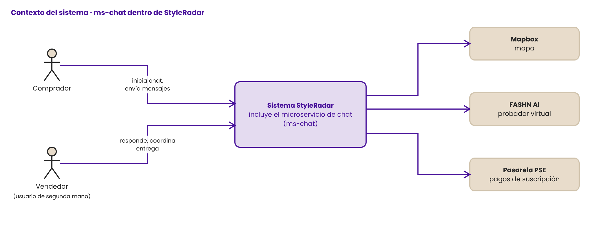
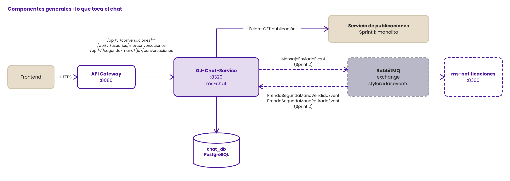
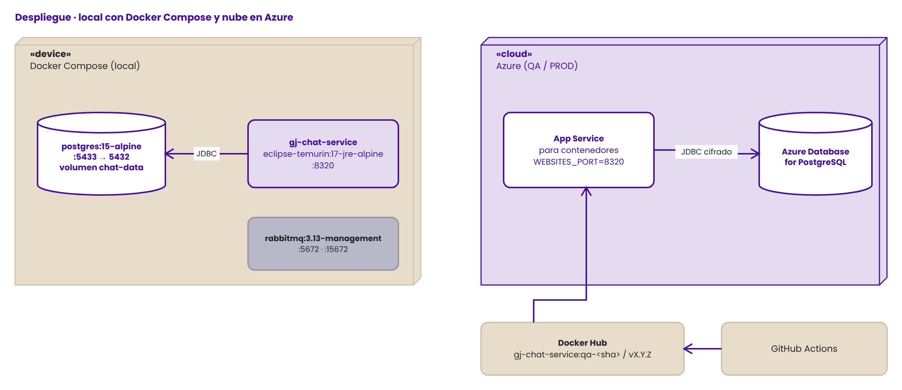
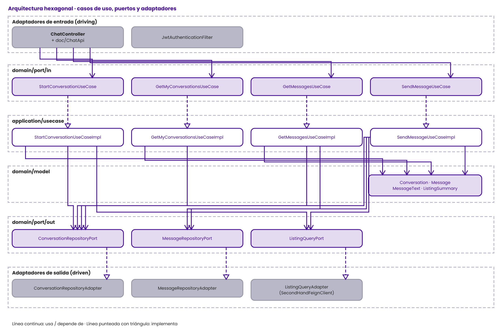
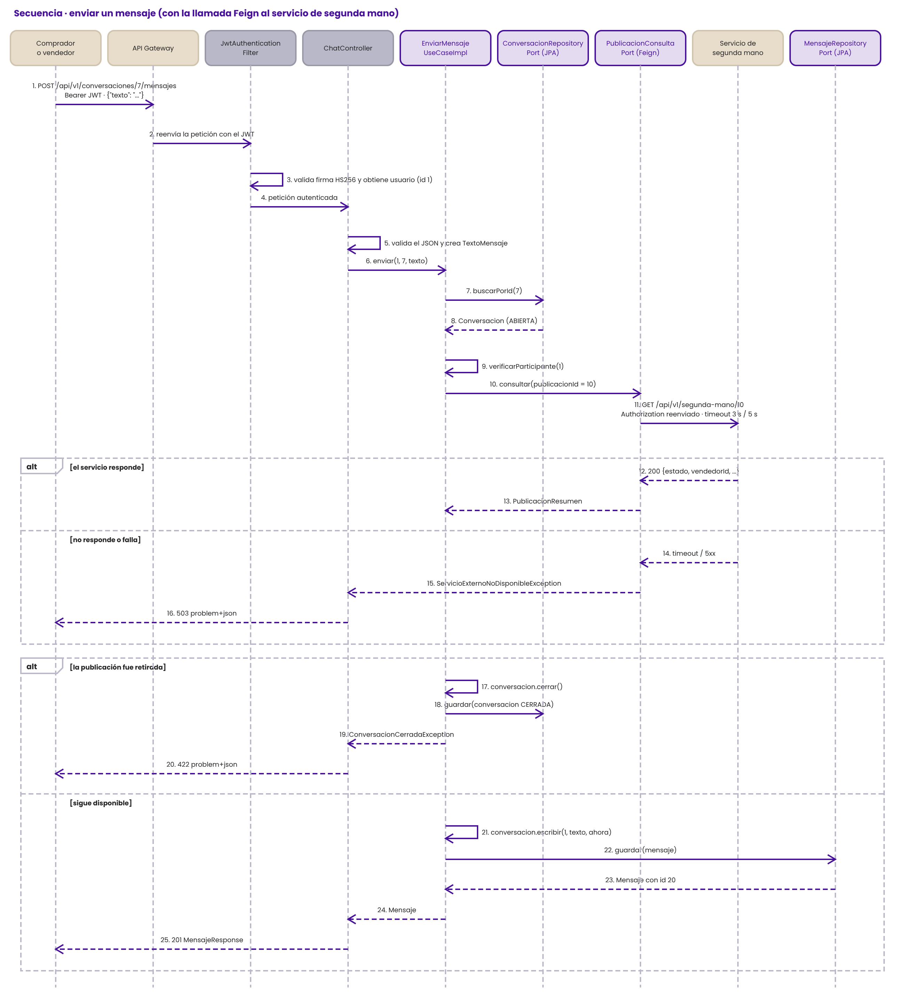
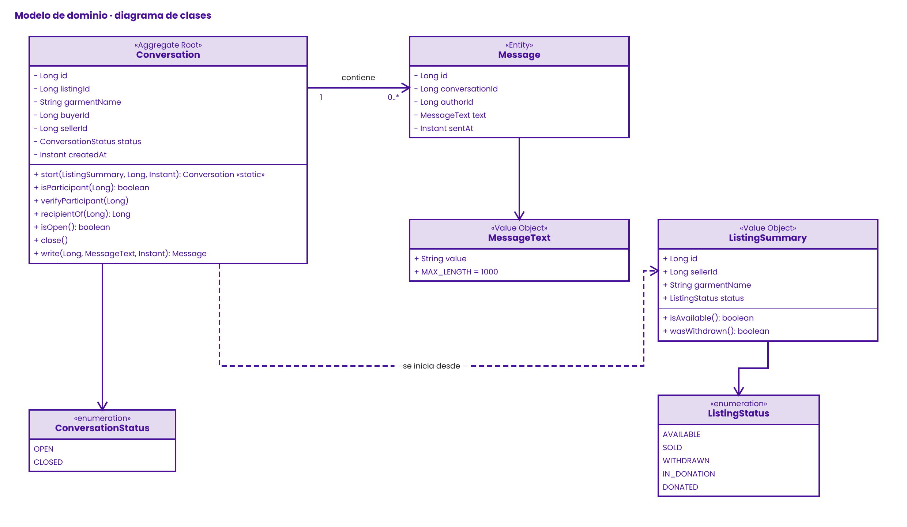
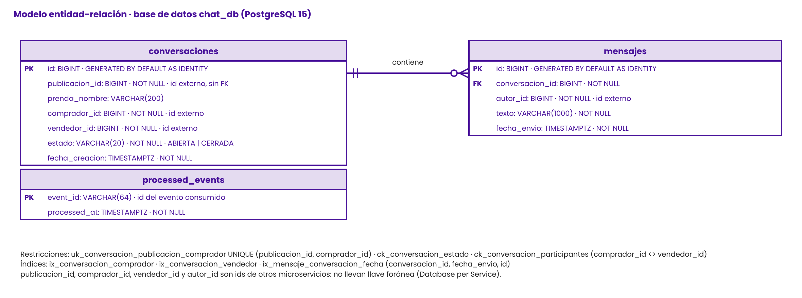

  

  <h1>STYLERADAR &nbsp;·&nbsp; <code>SR_GJ_DocumentoTecnico_v1</code></h1>

  

    
    
    
  

  
<em>Documento técnico de arquitectura de ms-chat · DOSW 2026-2</em>

| Campo | Valor |
| --- | --- |
| Microservicio | GJ-Chat-Service (`gj-chat-service`, puerto 8320) |
| Dominio / Paquete | P3: Chat / Notificaciones · bounded context **Mensajería** |
| Equipo | Guatoque Jiraguas (GJ) · Responsable: Santiago Andrés García Almario |
| Versión · Fecha | v1.1 · 3 de noviembre de 2026 (Sprint 1) |

> **Regla de oro:** cada diagrama va con su explicación y justificación. Los diagramas se editan en draw.io con la plantilla de componentes de StyleRadar y viven en `docs/diagramas/` (un `.drawio` editable y su `.png` por cada uno), así que quedan versionados junto al código.

---

##  CONTENIDO Y CONTROL DE CAMBIOS

| Versión | Fecha | Autor / Rol | Cambio | Estado |
| --- | --- | --- | --- | --- |
| v0.1 | 01/11/2026 | Santiago García (Backend) | Scaffolding hexagonal, dominio y casos de uso migrados del monolito | Borrador |
| v1.0 | 03/11/2026 | Santiago García (Backend) | Diagramas específicos, contratos OpenAPI, pruebas y CI/CD | Entregado Sprint 1 |
| v1.1 | 03/11/2026 | Santiago García (Backend) | Formato de la plantilla oficial, diagrama de secuencia con la llamada Feign y eventos con los nombres de la matriz del curso | Entregado Sprint 1 |
| v1.2 | 06/11/2026 | Santiago García (Backend) | Diagramas migrados de Mermaid a draw.io con la plantilla StyleRadar; puertos 8320 / 8300 | En revisión |

| Recurso | Ubicación |
| --- | --- |
| Repositorio | `GJ-Chat-Service` (organización del proyecto en GitHub) |
| Swagger UI | `http://localhost:8320/swagger-ui.html` · OpenAPI en `/v3/api-docs` |
| Pipeline | `.github/workflows/ci-qa.yml` y `ci-prod.yml` |
| Contratos de eventos | [`SR_GJ_ContratosEventos_v1.md`](SR_GJ_ContratosEventos_v1.md) |
| Esquema de base de datos | `src/main/resources/db/migration/V1__init_schema.sql` |
| Tablero Jira | Épica `GJ-1 · ms-chat` · _pegar el enlace de la épica_ |

---

##  MICROSERVICIOS Y TECNOLOGÍAS (FILA DE ESTE SERVICIO)

| Servicio | Equipo | ¿BD? | Tipo de BD | Framework | Broker |
| --- | --- | --- | --- | --- | --- |
| GJ-Chat-Service | Guatoque Jiraguas (GJ) | Sí | Relacional (PostgreSQL 15) | Spring Boot 3.2 · Java 17 | RabbitMQ (desde Sprint 2) |

**Justificación resumida:** las conversaciones y mensajes son datos con relaciones fijas (un mensaje pertenece a una conversación), restricciones de unicidad (una conversación por publicación y comprador) y consultas ordenadas por fecha; eso lo resuelve una base relacional con transacciones ACID. El detalle de cada decisión está en `SR_GJ_AnalisisTecnologias_v1.md`.

---

##  DIAGRAMAS GENERALES (VISTA DEL CURSO, DESDE ESTE SERVICIO)

Los diagramas generales completos los hace todo el curso. Aquí se muestra cómo encaja GJ-Chat-Service en ellos.

### 2.1 Contexto

Editable en draw.io: <a href="diagramas/contexto-del-sistema.drawio"><code>contexto-del-sistema.drawio</code></a>

El chat lo usan dos usuarios finales: el **comprador**, que inicia la conversación desde una publicación de segunda mano, y el **vendedor**, que responde y acuerda la entrega. El chat no se integra con ningún sistema externo; los sistemas externos del contexto (Mapbox, FASHN AI, PSE) pertenecen a otros servicios.

### 2.2 Componentes general (lo que toca el chat)

Editable en draw.io: <a href="diagramas/componentes-general.drawio"><code>componentes-general.drawio</code></a>

El frontend nunca llama al chat directamente: entra por el **API Gateway**, que valida el JWT y enruta. El chat tiene **su propia base de datos** y no lee la de ningún otro servicio. Lo único que necesita de otro contexto (el estado y el dueño de una publicación) lo pide por **REST con Feign**, porque necesita la respuesta en ese momento para decidir si deja iniciar el chat. Las notificaciones y el cierre de la conversación cuando la prenda se vende o se retira no necesitan respuesta inmediata, por eso irán por **eventos en RabbitMQ**: así el chat no depende de que ms-notificaciones esté arriba.

### 2.3 Despliegue

Editable en draw.io: <a href="diagramas/despliegue.drawio"><code>despliegue.drawio</code></a>

En local, `docker compose up --build` levanta la base y el servicio; el servicio espera a que PostgreSQL esté sano (`healthcheck`) antes de arrancar. En la nube, GitHub Actions construye la imagen multi-stage, la publica en Docker Hub y la despliega en un App Service con sus variables de entorno (`DB_URL`, `JWT_SECRET_BASE64`, `SEGUNDA_MANO_URL`). La misma imagen corre en los dos ambientes; solo cambian las variables.

---

##  CONTEXTO Y ALCANCE DEL SERVICIO

| HU / RF | Historia de usuario | Criterio de aceptación principal | Estado |
| --- | --- | --- | --- |
| HU-01 · SR-RF-40 | Como comprador, quiero iniciar una conversación con el dueño de una prenda de segunda mano, para preguntarle por ella antes de comprarla. | Solo sobre publicaciones disponibles y ajenas; si ya existe, devuelve la misma | Implementado |
| HU-02 · SR-RF-41 | Como comprador o vendedor, quiero enviar y leer mensajes, para acordar el lugar y el momento de la entrega. | Solo participantes; máximo 1.000 caracteres; no se escribe si la publicación fue retirada | Implementado |
| HU-03 · SR-RF-41 | Como usuario, quiero ver mis conversaciones como comprador y como vendedor, para retomarlas. | El usuario sale del JWT, nunca de la URL | Implementado |
| HT-01 | Como equipo, queremos el chat como servicio independiente con su base, pipeline e imagen Docker. | Arranca solo, sin llaves foráneas a otros servicios, pipeline en verde | Implementado |

| Servicio relacionado | Relación | Canal | Propósito |
| --- | --- | --- | --- |
| API Gateway | Upstream | HTTP/REST | Recibe las peticiones con el JWT |
| Servicio de publicaciones de segunda mano (Sprint 1: monolito; después: paquete Catálogo) | Downstream | REST (Feign) y eventos (Sprint 2) | Validar estado y dueño de la publicación; cerrar el chat cuando se vende o se retira |
| Servicio de identidad | Emisor del JWT | Llave HS256 compartida | Autenticar sin consultar la base de usuarios |
| ms-notificaciones | Downstream | RabbitMQ (Sprint 2) | Avisar mensajes nuevos (`MensajeEnviadoEvent`) |

> **Aislamiento de dominio:** el servicio no accede a la base de ningún otro. Publicaciones y usuarios se guardan solo como ids (`publicacionId`, `compradorId`, `vendedorId`, `autorId`).

---

##  ARQUITECTURA HEXAGONAL ESPECÍFICA

Editable en draw.io: <a href="diagramas/arquitectura-hexagonal-detalle.drawio"><code>arquitectura-hexagonal-detalle.drawio</code></a>

**Explicación.** Los adaptadores de entrada traducen HTTP: `JwtAuthenticationFilter` valida el token y deja al usuario en el contexto, y `ChatController` solo conoce las interfaces de `port/in`. Cada caso de uso es una interfaz con su `*UseCaseImpl` en `application/usecase`, registrado como `@Bean` en `BeanConfig` (sin `@Service`). Las reglas del negocio viven en el dominio y no dependen de Spring ni de JPA. Los casos de uso piden lo externo por puertos de salida, que implementan los adaptadores: JPA para la base y Feign para el servicio de publicaciones.

**Flujo de una petición (enviar mensaje):** `POST /api/v1/conversaciones/7/mensajes` → `JwtAuthenticationFilter` (usuario 1 desde el JWT) → `ChatController` convierte el JSON a `MessageText` con `MessageDtoInMapper` → `SendMessageUseCase.send(1, 7, texto)` → `SendMessageUseCaseImpl` busca la conversación por `ConversationRepositoryPort`, verifica que el usuario participe y, si sigue abierta, consulta la publicación por `ListingQueryPort` → `Conversation.write(...)` aplica las reglas y crea el `Message` → `MessageRepositoryPort.save` → `MessageRepositoryAdapter` lo convierte a `MessageJpaEntity` y lo persiste → la respuesta vuelve como `MessageResponse` (201).

**Justificación.** Separar así permite cambiar de dónde sale la publicación (hoy el monolito, después el servicio de Catálogo, o un evento) cambiando solo un adaptador, y probar todas las reglas con JUnit y Mockito sin levantar Spring ni una base de datos.

### Diagrama de secuencia · enviar un mensaje (actualiza la secuencia 7.5 con la llamada Feign)

Editable en draw.io: <a href="diagramas/secuencia-enviar-mensaje.drawio"><code>secuencia-enviar-mensaje.drawio</code></a>

**Explicación.** El diagrama recorre el caso de uso de SR-RF-41 de punta a punta. La autenticación ocurre una sola vez, en el filtro; el controlador y el caso de uso reciben el id del usuario ya validado. El cambio frente a la secuencia 7.5 del monolito son los pasos 10 y 11: como la publicación ya no vive en la misma base, el caso de uso la pide por `ListingQueryPort`, y el adaptador Feign hace la llamada HTTP al servicio dueño, reenviando el mismo JWT y con tiempos límite de 3 s para conectar y 5 s para leer.

**Justificación.** La llamada es síncrona porque el chat necesita saber en ese momento si la publicación sigue disponible antes de guardar el mensaje. Si el servicio de publicaciones no responde, el chat devuelve un `503` claro en lugar de quedarse esperando. En el Sprint 2 esta consulta se reemplaza por los eventos de [`SR_GJ_ContratosEventos_v1.md`](SR_GJ_ContratosEventos_v1.md): el chat cerrará la conversación al recibir el evento y ya no tendrá que llamar al otro servicio en cada mensaje.

---

##  MODELO DE DOMINIO Y DIAGRAMA DE CLASES

Editable en draw.io: <a href="diagramas/modelo-de-dominio-clases.drawio"><code>modelo-de-dominio-clases.drawio</code></a>

**Explicación.** `Conversation` es el agregado raíz: toda escritura pasa por `write(...)`, que garantiza las invariantes (solo participantes, conversación abierta). `start` es un método de fábrica que exige una publicación disponible y ajena. `Message` es inmutable una vez creado. `MessageText` es un value object: valida al crearse que el texto no esté vacío, le quita los espacios sobrantes y limita a 1.000 caracteres, así un texto inválido nunca llega a existir dentro del dominio. `ListingSummary` es la copia mínima e inmutable de un dato que pertenece a otro contexto. Las excepciones del dominio (`ConversationNotFoundException`, `ConversationClosedException`, `ListingUnavailableException`, `SelfChatException`, `InvalidMessageTextException`) no saben de HTTP; la infraestructura las traduce.

**Justificación.** Poner las reglas en el agregado y en value objects evita un modelo anémico: el controlador y los casos de uso no pueden saltarse una validación porque la regla está en el objeto mismo. El evento `MensajeEnviadoEvent` se agrega en el Sprint 2.

---

##  MODELO DE BASE DE DATOS

Editable en draw.io: <a href="diagramas/modelo-entidad-relacion.drawio"><code>modelo-entidad-relacion.drawio</code></a>

| Restricción / índice | Para qué |
| --- | --- |
| `UNIQUE (publicacion_id, comprador_id)` | Una sola conversación por publicación y comprador; si dos peticiones llegan a la vez, la base rechaza la segunda y el adaptador devuelve la existente |
| `CHECK (estado IN ('ABIERTA','CERRADA'))` | Solo estados válidos |
| `CHECK (comprador_id <> vendedor_id)` | Nadie conversa consigo mismo, también a nivel de base |
| `ix_conversacion_comprador`, `ix_conversacion_vendedor` | «Mis conversaciones» busca por comprador o vendedor |
| `ix_mensaje_conversacion_fecha (conversacion_id, fecha_envio, id)` | Los mensajes se leen ordenados por fecha sin ordenar en memoria |

**Explicación.** Se eligió PostgreSQL relacional porque el modelo es pequeño, estable y relacional, y porque la unicidad de la conversación debe garantizarse con transacciones ACID. La única llave foránea es interna (mensajes → conversaciones). Publicación, comprador, vendedor y autor son ids de otros servicios y **no tienen llave foránea** (Database per Service). El esquema lo crea Flyway con `V1__init_schema.sql`; Hibernate solo lo valida (`ddl-auto: validate`). Las fechas se guardan con zona horaria en UTC.

---

##  CONTRATOS DE API REST Y EVENTOS

| Método | Ruta | Descripción | Rol | HTTP |
| --- | --- | --- | --- | --- |
| POST | `/api/v1/segunda-mano/{publicacionId}/conversaciones` | Iniciar chat con el vendedor (idempotente) | COMPRADOR | 200, 401, 403, 404, 422, 503 |
| GET | `/api/v1/usuarios/me/conversaciones` | Mis conversaciones | COMPRADOR | 200, 401, 403 |
| GET | `/api/v1/conversaciones/{id}/mensajes` | Mensajes en orden de envío | COMPRADOR (participante) | 200, 401, 403, 404 |
| POST | `/api/v1/conversaciones/{id}/mensajes` | Enviar mensaje | COMPRADOR (participante) | 201, 400, 401, 403, 404, 422, 503 |

| Evento | Dirección | Exchange · routing key | Payload resumido | Sprint |
| --- | --- | --- | --- | --- |
| `MensajeEnviadoEvent` | Publica | `styleradar.exchange` → `styleradar.chat.mensaje.enviado` | `{ "mensajeId": 20, "conversacionId": 7, "autorId": 1, "destinatarioId": 2, "fechaEnvio": "…" }` | 2 |
| `PrendaSegundaManoVendidaEvent` | Consume | `styleradar.exchange` → `styleradar.segundavida.prenda.vendida` | `{ "publicacionId": 10, "vendedorId": 2, "compradorId": 1, "fechaVenta": "…" }` | 2 |
| `PrendaSegundaManoRetiradaEvent` *(propuesto)* | Consume | `styleradar.exchange` → `segunda-mano.prenda.retirada` | `{ "publicacionId": 10, "vendedorId": 2, "fechaRetiro": "…" }` | 2 |

Los campos completos, el sobre común (`eventId`, `version`, `correlationId`…), las reglas de idempotencia y la tabla de aprobación están en [`SR_GJ_ContratosEventos_v1.md`](SR_GJ_ContratosEventos_v1.md).

**Errores RFC 7807:** todas las respuestas de error son `application/problem+json` con `type`, `title`, `status`, `detail`, `instance` y `timestamp`. Los errores de validación agregan `errores` por campo. Cada código tiene su ejemplo en Swagger.

---

##  PRUEBAS Y CALIDAD

| Nivel | Herramienta | Paquete | Pruebas |
| --- | --- | --- | --- |
| Unitarias · dominio | JUnit 5 | `domain.model` | 25 |
| Unitarias · caso de uso | JUnit 5 + Mockito | `application.usecase` | 14 |
| Adaptadores | JUnit 5 + Mockito | `infrastructure.adapter.out` | 14 |
| API | Spring `@WebMvcTest` + MockMvc | `infrastructure.adapter.in.rest` | 17 |
| Integración · persistencia | Spring Boot Test + Testcontainers (PostgreSQL 15) | `infrastructure` | 4 |
| **Total** | | | **74** |

Cobertura JaCoCo de dominio y aplicación: **100 % de líneas** (mínimo 85 %, verificado por `mvn verify`). Análisis estático con Checkstyle (Google Java Style) en el pipeline.

| Evidencia | Dónde se obtiene |
| --- | --- |
| E1 · Swagger UI | `http://localhost:8320/swagger-ui.html` con `docker compose up` |
| E2 · Pipeline en verde | Pestaña Actions del repositorio, workflow **CI QA** |
| E3 · Reporte JaCoCo | Artefacto `reportes-calidad` del pipeline o `target/site/jacoco/index.html` |
| E4 · Contenedor corriendo | `docker compose ps` |

---

##  CHECKLIST DE ENTREGA

| Estado | Criterio | Verificación |
| --- | --- | --- |
| Cumple | Estructura hexagonal con interfaz + `Impl` y dominio sin frameworks | Paquetes `domain`, `application`, `infrastructure` |
| Cumple | Dockerfile multi-stage y docker-compose | `docker compose up --build` |
| Cumple | Versiones fijas y secretos fuera del repo | `pom.xml`, `.env.example` |
| Cumple | Pipeline: build → pruebas → análisis estático y cobertura → imagen Docker | `ci-qa.yml` |
| Cumple | Swagger con descripción, ejemplos y códigos de error | `/swagger-ui.html` |
| Cumple | README con las 12 secciones | `README.md` |
| Cumple | Diagramas con explicación: hexagonal, secuencia, clases y base de datos | Secciones 04, 05 y 06 |
| Pendiente | Contratos de eventos aprobados por Catálogo y Notificaciones | `SR_GJ_ContratosEventos_v1.md`, sección de aprobación |
| Pendiente | Despliegue en Azure | Pendiente de crear el App Service y cargar los secrets |
